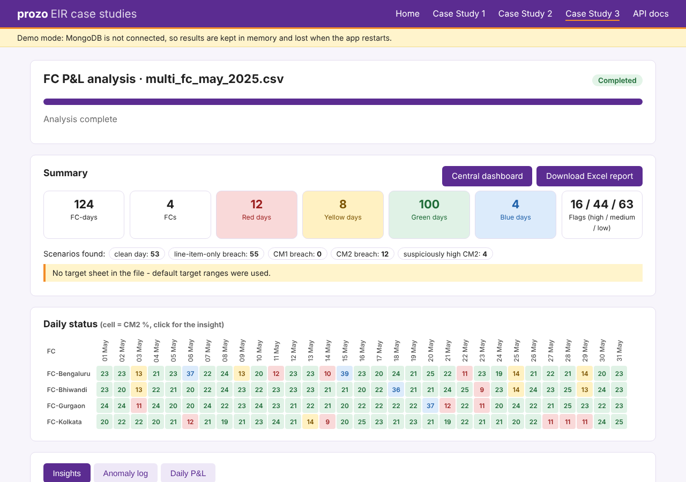

# Prozo EIR (Agentic AI): Case Studies 1, 2 and 3
Demo Deployed App: https://case-study-prozo.onrender.com/

One web app with three working solutions. Open it, pick a case study from the home page, upload the files, and get results you can download.

| | Case Study 1 | Case Study 2 | Case Study 3 |
|---|---|---|---|
| **In one line** | Read AWB, size and weight from parcel photos | Check that contractors really paid workers' PF and ESIC | Tell each warehouse manager, the same day, when profit slips and why |
| **You upload** | Parcel photos (or a ZIP) | Wagesheet (Excel) + PF ECR (PDF) + ESIC ECR (PDF) | Daily revenue and costs per warehouse (CSV / Excel) |
| **You get** | One row per photo, with a status, as CSV | A verdict and a reason for every worker, as Excel | A colour per warehouse per day, the cause, and a daily email |
| **Read more** | [Case Study 1 section](#case-study-1-parcel-images-to-shipment-data) | [Case Study 2 section](#case-study-2-wagesheet-vs-pf--esic-verification) | [Case Study 3 section](#case-study-3-daily-fc-pl-monitor-and-alert-digest) |
| **Documents** | [Roadmap & workflow](docs/case_study_1/CS1_Roadmap_and_Workflow.docx) | [Roadmap & workflow](docs/case_study_2/CS2_Roadmap_and_Workflow.docx) | [Requirements](docs/case_study_3/CS3_Requirements_and_Workflow.docx) · [Roadmap](docs/case_study_3/CS3_Roadmap_and_Workflow.docx) |
| **Open in the app** | [localhost:8000/case-study-1](http://localhost:8000/case-study-1) | [localhost:8000/case-study-2](http://localhost:8000/case-study-2) | [localhost:8000/case-study-3](http://localhost:8000/case-study-3) |

**The idea behind all three:** numbers are decided by plain code, so they are exact and can be explained. AI is used only where it helps (checking a photo, writing a sentence), and it can never change a number. When the system is not sure, it says so instead of guessing.

---

## Quick start

```bash
cd prozo-compliance-poc
python3 -m venv .venv && source .venv/bin/activate
pip install -r requirements.txt
./run.sh                          # then open http://localhost:8000
```

- Settings go in a `.env` file (copy `.env.example`): MongoDB address, Gemini key, email. **Everything works without them.** The app uses a temporary in-memory database and skips the AI steps.
- Sample files to try are in `data/case_study_1/`, `data/case_study_2/` and `data/case_study_3/`.

---

## Case Study 1: Parcel images to shipment data

### The problem
At scanning stations a camera photographs every parcel, and a person types the tracking number (AWB), weight and size from each photo into a sheet. Some photos can't be read: an empty belt, two parcels, half a parcel, a hand in the way. **A wrong value is worse than an honest "can't read this".**

### What the photos showed
The sample photos are frames from **sorting machines**. The machine measures each parcel and prints its readings on the photo (AWB, length, width, height, weight, time). Each site prints them in a different layout, sometimes without units (`Dimension: 0208 X 0148 X 0163` is in millimetres; `Weight: 01190` is in grams).

### Which source we trust, and why
| Source | What it has | How we use it |
|---|---|---|
| **Machine readings printed on the photo** | AWB, length, width, height, weight | **Main source.** Measured by the machine, present on every frame, clean printed text |
| **Courier label on the parcel** | AWB (barcode and printed number) only | **Check.** Its barcode independently confirms the AWB. Used as the source only when a photo has no machine readings |

Why not the label first? It has no weight or size, and in sorter photos it is small, rotated and often partly hidden. If the machine and the label give **different AWBs**, we don't pick one: the photo is marked for review.

### Our solution
Each photo is read by up to three independent readers. **A value goes into the CSV only when two of them agree.**

1. **Text reader (OCR, offline):** reads the machine's printed text and understands any layout ("AWB No", "Barcode:", "LENGTH(cm)", "0208 X 0148 X 0163" …).
2. **Barcode reader (offline):** reads the label's barcode to confirm the AWB.
3. **Gemini (optional AI):** checks the photo itself (one parcel? cut off? covered?) and reads the values a second time.

Then simple checks run: values in a sensible range (1-250 cm, 0.01-100 kg), and the printed volume must match L × W × H. Weight is always the **actual weight in kg**, size is in **cm**; volumetric weight is kept only as evidence.

### What each photo gets
| Status | Meaning |
|---|---|
| OK | Values confirmed and checked |
| NEEDS_REVIEW | Readable, but a check failed (readers disagree, value out of range, volume mismatch) |
| PARCEL_PARTIAL · MULTIPLE_PARCELS · NO_PARCEL · VIEW_OBSTRUCTED | Problem with the photo itself (found by Gemini) |
| UNREADABLE | Nothing readable on the photo |
| INVALID_IMAGE | Not an image, broken or too small |
| PROCESSING_ERROR | The AI call failed; the photo can be re-read |

The CSV columns `awb, length_cm, width_cm, height_cm, weight_kg` are filled only for OK photos. What was read is always kept in the `*_as_read` columns, with a reason and notes. A review screen lets a person fix flagged photos in seconds.

### Results
- **5 sample photos:** all values read exactly.
- **41 test photos** covering every problem type and 2 layouts never seen before: all statuses as expected, **0 wrong values**.
- Without a Gemini key the app still works (offline mode) but can't see photo problems such as a half-captured parcel. The page says so.


---

## Case Study 2: Wagesheet vs PF / ESIC verification

### The problem
Contractors deduct PF (12%) and ESIC (0.75%) from workers' wages and must deposit it with the government. **If they don't, Prozo is legally liable.** Each month HR compares the contractor's wagesheet with two government filings (PF ECR and ESIC ECR, as PDFs), worker by worker. With hundreds of workers this is slow and error-prone.

### Our solution
For every worker the app checks three things: **is the worker in the filing** (by UAN / IP number), **is it the same person** (name), and **is the amount right**.

- **Names are compared word by word**, not by one similarity score, because a score can't tell SUNITA / SUNEETA (same person) from RENU / REKHA (different people). Indian spelling variations, word order, titles (Mr, Smt) and initials are allowed. A different first name or surname never is.
- **Amounts:** a difference of up to **₹1** is accepted (PF and ESIC rounding). The app also recalculates from the wages in the filing and says **which side is wrong**: the wagesheet or the deposit.
- **PDF reading:** these filings have no table lines, so the app rebuilds the table from the position of every word. It then compares its totals with the totals printed in the filing, so a missed row can't go unnoticed.

### What each worker gets (one row per worker, per check)
| Status | Meaning |
|---|---|
| Matched | Same ID, same person, amount within ±₹1 |
| Name mismatch | The ID belongs to someone else. **If the amount is also wrong, the row stays Name mismatch and shows the amount difference** |
| Amount mismatch | Right person, wrong amount (short or excess deposit) |
| Missing | Not in the filing, or the ID is blank, invalid or damaged by Excel |

Plus a list of people who are in the filing but not in the wagesheet, a 6-sheet Excel report, and an **Ask** box ("Who is missing in ESIC?"). AI, if switched on, only rewrites the answer; every number must match the stored results.

### Results
- **Sample files:** matches the hand-made answer key exactly.
- **Generated test sets** (up to 1,500 workers, 50-page PDFs): **100% correct on 3,544 checks**, in about 5 seconds.


---

## Case Study 3: Daily FC P&L monitor and alert digest

### The problem
Each fulfilment centre (FC) has daily revenue and six costs. Margin problems are found days late, from spreadsheets. Prozo wants to know **the same day**, and **which cost** caused it.

- **CM1** = revenue − manpower − packaging (target 65-70%)
- **CM2** = CM1 − power & fuel − rent − equipment − overheads (target 15-30%)
- A day is flagged when a cost is outside its range, or CM1 / CM2 is more than 3 points from target: **CM1 outside 62-73%, CM2 outside 12-33%** (reading confirmed by Prozo).

| Colour (by CM2) | Rule | Meaning |
|---|---|---|
| Red | below 12% | Losing margin, act today |
| Yellow | 12-15% or 30-33% | Outside the healthy band |
| Green | 15-30% | Healthy |
| Blue | above 33% | Too good to be true: a cost may be missing |

### Our solution
A chain of small steps ("agents"), each with one job:

1. **Read** the file (any column order) and the target ranges.
2. **Calculate** cost %, CM1, CM2 and the colour.
3. **Check** every cost and margin; rate it high / medium / low; work out the **rupee impact** (how much over its limit).
4. **Explain** in plain English: what went wrong, the top causes by rupees, what to do.
5. **Remember** every day per FC, so it can say "3rd Red day in a row".
6. **Send** each FC manager a colour-coded daily email (or save it to a file if email isn't set up), automatically at a set time if wanted.

Why ranking matters: in the sample, **99 of 100 days break at least one rule**. Without ranking, the alert becomes noise. Managers can also mark a known issue (for example "quarterly rent") so it stops alerting.

### Results
- **Sample file (100 days):** 86 Green, 11 Yellow, 3 Red, 0 Blue, matching a hand calculation.
- **Generated file (4 FCs × 31 days):** all 124 days classified as planned, including a clean day, a CM2 breach, a cost-only breach and a suspiciously high CM2.



---

## How it is built

### Tools used
| Tool | What it does here |
|---|---|
| Python + FastAPI | The web app and its API (auto documentation at `/docs`) |
| HTML templates + plain JavaScript | The pages; no separate frontend build |
| MongoDB | Stores jobs, results and history (in-memory fallback for demos) |
| pdfplumber, openpyxl | Read the PDFs and Excel files; write Excel reports (Case Study 2, 3) |
| RapidOCR, zxing-cpp | Read text and barcodes in photos, offline (Case Study 1) |
| Gemini (optional) | Photo check (CS1), friendlier wording (CS2, CS3) |
| Background workers | Long jobs run in the background, so the page never freezes |
| pytest | 163 automated tests |

### What happens when you click Upload
1. The page sends the files to the server.
2. The server checks them (type, size, empty) and replies straight away with a job number.
3. A background worker does the work and saves progress to the database.
4. The page asks "is it done?" every second or two and moves the progress bar.
5. When it's done, the page shows the summary, tables and download buttons.

### Folder structure
Every top-level folder has one sub-folder per case study, so everything about one case study is easy to find.

```
prozo-compliance-poc/
├── app/
│   ├── main.py, config.py, container.py   start-up, settings, wiring
│   ├── shared/                 database, AI client, home page (used by all three)
│   ├── case_study_1/           photos -> shipment CSV
│   ├── case_study_2/           wagesheet vs PF / ESIC
│   ├── case_study_3/           daily P&L monitor
│   ├── templates/              HTML pages, one folder per case study
│   └── static/                 CSS and JavaScript, one folder per case study
├── data/                       sample and test files
├── scripts/                    test-data generators and accuracy checks
├── outputs/                    results produced from the test files
├── tests/                      automated tests
└── docs/                       Word documents, interview guide, screenshots
```

The interview preparation guide is in [docs/Prozo_EIR_Interview_Prep_Guide.docx](docs/Prozo_EIR_Interview_Prep_Guide.docx).

Inside each case study the same file names do the same job:

| File | Job |
|---|---|
| `rules.py` | **Every business rule and threshold.** Most changes are one line here |
| `models.py` | The shape of the data |
| `api.py` / `pages.py` | What the browser can ask for / which page opens |
| `repository.py` | All database reads and writes |
| `service.py` (or `pipeline.py`, `job_runner.py`) | Runs the steps in order, in the background |

### Checking it works

```bash
python -m pytest                              # 163 tests
python scripts/case_study_1/evaluate.py       # photos vs answer keys
python scripts/case_study_2/evaluate.py       # verdict accuracy on every test set
python scripts/case_study_3/evaluate.py       # colours and planned scenarios
```

---

## Decisions confirmed with Prozo

| Question | Answer | Where it lives |
|---|---|---|
| Which source to trust for photos | Our decision (see Case Study 1) | `app/case_study_1/decision.py` |
| Units for photo values | Weight in kg, size in cm, actual weight (not volumetric) | `app/case_study_1/rules.py` |
| Name and amount both wrong | One row, status Name mismatch, amount difference shown | `app/case_study_2/matching/verifier.py` |
| Rounding difference | Up to ₹1 is fine | `AMOUNT_TOLERANCE_RUPEES` in `app/case_study_2/rules.py` |
| "±3 points" | CM1 flagged outside 62-73%, CM2 outside 12-33% | `CM_TOLERANCE_PTS` in `app/case_study_3/rules.py` |

## Limitations and next steps
- **Case Study 1:** the Gemini photo check has been tested with recorded answers only, so it still needs measuring on real photos. Units not printed on the photo are worked out by rule (and noted on the row).
- **Case Study 2:** tuned to the sample filing layouts. Scanned (image) PDFs need OCR.
- **Case Study 3:** emails only so far. WhatsApp / Slack and learning each FC's normal range are next.
- **For production:** user login, a proper job queue, file storage in the cloud, and direct data feeds instead of uploads.

## Troubleshooting
- **`SSL handshake failed … BAD_PSK_IDENTITY` (MongoDB Atlas):** Apple's built-in Python 3.9 has an old SSL library. Run `pip install -r requirements.txt` again (it installs a compatible pymongo), or use Python 3.11+.
- **AI calls fail / photos show PROCESSING_ERROR:** `gemini-2.0-flash` was shut down on 1 June 2026. Set `GEMINI_MODEL` and `CS1_VISION_MODEL` in `.env` to a current model from Google AI Studio.
- **Never share `.env`:** it holds your keys and passwords.
