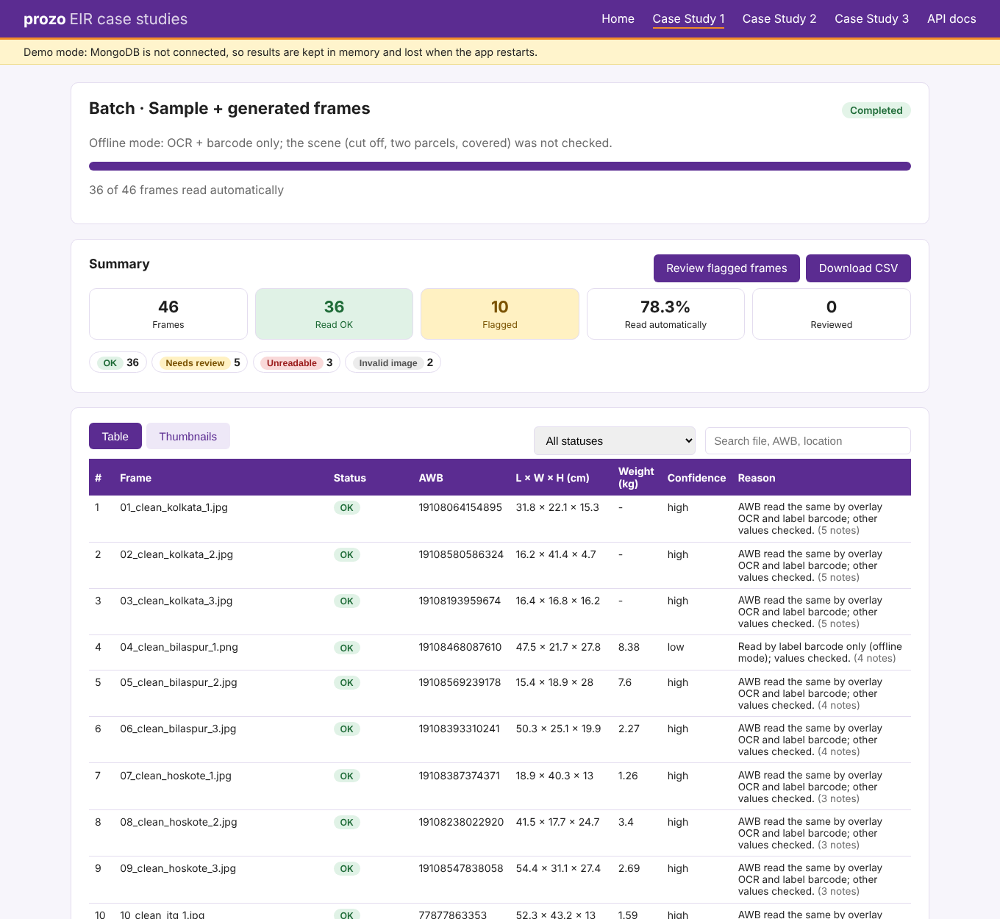
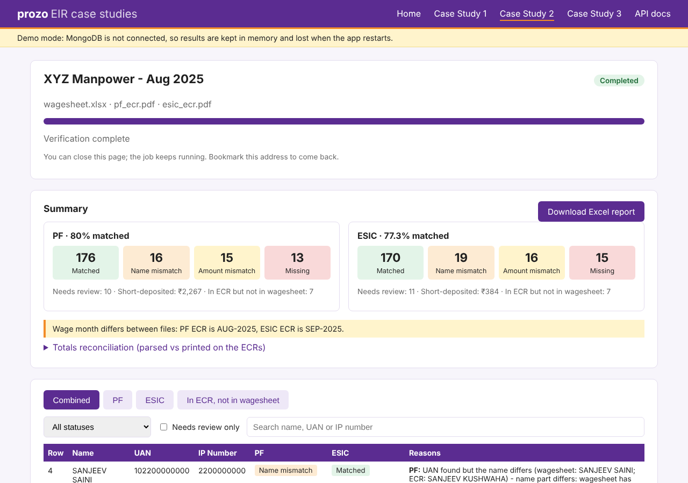

# Prozo EIR (Agentic AI): Case Studies 1, 2 and 3

One web app with three working proofs of concept. Open the home page, pick a case study, upload the files, and download the results.

| | Case Study 1 | Case Study 2 | Case Study 3 |
|---|---|---|---|
| **What it does** | Reads AWB, size and weight from parcel photos | Checks that contractors deposited every worker's PF and ESIC | Tells each FC manager, the same day, when margins slip and why |
| **You upload** | Parcel photos or a ZIP | Wagesheet (Excel) + PF ECR + ESIC ECR (PDF) | Daily revenue and costs per FC (CSV / Excel) |
| **You get** | One row per photo with a status (CSV) | A verdict and reason per worker (Excel) | A colour per FC per day, the cause, a daily email |
| **Details** | [Section](#case-study-1-parcel-images-to-shipment-data) · [Document](docs/case_study_1/Case_Study_1_Parcel_Images_to_Shipment_Data.docx) | [Section](#case-study-2-wagesheet-vs-pf--esic-verification) · [Document](docs/case_study_2/Case_Study_2_Wagesheet_vs_PF_ESIC.docx) | [Section](#case-study-3-daily-fc-pl-monitor-and-alert-digest) · [Document](docs/case_study_3/Case_Study_3_FC_PnL_Monitor.docx) |
| **Open in the app** | [/case-study-1](http://localhost:8000/case-study-1) | [/case-study-2](http://localhost:8000/case-study-2) | [/case-study-3](http://localhost:8000/case-study-3) |

**One principle across all three:** numbers are decided by plain code, so they are exact and explainable. AI is used only where it helps (checking a photo, wording a sentence) and can never change a number. When the system is unsure, it flags the case instead of guessing.

---

## How to run

```bash
./run.sh                 # creates .venv, installs requirements, starts the app
# open http://localhost:8000
```

Or with Docker (includes MongoDB): `docker compose up --build`

- **No setup needed for a demo.** Without a database the app uses a temporary in-memory one; without an AI key it skips the AI steps.
- **Optional settings** go in `.env` (copy `.env.example`): `MONGO_URI`, `GEMINI_API_KEY`, email (SMTP) for Case Study 3.
- **Sample files** are in `data/case_study_1/`, `data/case_study_2/` and `data/case_study_3/`.

---

## Case Study 1: Parcel images to shipment data

**Problem.** A person types the AWB, weight and size from every scanning-station photo into a sheet. Some photos can't be read (empty belt, two parcels, half a parcel, a hand in the way), and **a wrong value is worse than an honest flag.**

**Which source we trust, and why.** The sample photos come from sorting machines that **print their own measurements on the photo** (AWB, length, width, height, weight), in a different layout at each site.

| Source | What it has | How we use it |
|---|---|---|
| Machine readings on the photo | AWB, length, width, height, weight | **Main source:** measured by the machine, present on every frame, clean printed text |
| Courier label | AWB only | **Check:** its barcode confirms the AWB; used as the source only when a photo has no machine readings |

The label has no weight or size and is often small, rotated or partly hidden. If the machine and the label disagree on the AWB, the photo goes to review instead of the app picking one.

**Solution.** Up to three independent readers per photo, and **a value is accepted only when two agree**:
1. **Text reader (offline OCR):** reads the printed readings in any layout.
2. **Barcode reader (offline):** confirms the AWB from the label.
3. **Gemini (optional):** checks the photo itself (one parcel? cut off? covered?) and reads the values again.

Values must also be sensible (1-250 cm, 0.01-100 kg), and a printed volume must match L × W × H. Output is **weight in kg (actual, not volumetric) and size in cm**.

**What each photo gets.**

| Status | Meaning |
|---|---|
| OK | Values confirmed and checked |
| NEEDS_REVIEW | Readable, but a check failed (readers disagree, out of range, volume mismatch) |
| PARCEL_PARTIAL · MULTIPLE_PARCELS · NO_PARCEL · VIEW_OBSTRUCTED | A problem with the photo itself |
| UNREADABLE · INVALID_IMAGE | Nothing readable / not a usable image |
| PROCESSING_ERROR | The AI call failed; the photo can be re-read |

Values are filled only for OK photos; what was read is always kept as evidence. A review screen lets a person fix flagged photos.

**Results.** 5 / 5 sample photos read exactly. 41 test photos (every problem type, 2 unseen layouts): all statuses as expected, **0 wrong values**.



---

## Case Study 2: Wagesheet vs PF / ESIC verification

**Problem.** Contractors deduct PF (12%) and ESIC (0.75%) from wages and must deposit them. **If they don't, Prozo is liable.** HR compares the wagesheet with two government filings (PDFs), worker by worker, which is slow and error-prone.

**Solution.** For every worker the app checks: **in the filing?** (by UAN / IP number) **Same person?** (name) **Right amount?**
- **Names are compared word by word,** so spelling variants (SUNITA / SUNEETA) pass but different people (RENU / REKHA) don't. Word order, titles and initials are allowed.
- **Amounts** may differ by up to **₹1** (rounding). The app also recalculates from the filed wages and says **which side is wrong**.
- **PDFs** have no table lines, so the table is rebuilt from word positions, and its totals are checked against the totals printed in the filing.

**What each worker gets.**

| Status | Meaning |
|---|---|
| Matched | Same ID, same person, amount within ±₹1 |
| Name mismatch | The ID belongs to someone else. If the amount is also wrong, it stays **one row**, marked Name mismatch, **with the amount difference shown** |
| Amount mismatch | Right person, wrong amount |
| Missing | Not in the filing, or the ID is blank, invalid or damaged by Excel |

Also: people in the filing but not in the wagesheet, a 6-sheet Excel report, and an **Ask** box ("Who is missing in ESIC?").

**Results.** Sample files match the hand-checked answer key exactly. Test sets up to 1,500 workers and 50-page PDFs: **100% correct on 3,544 checks**, in about 5 seconds.



---

## Case Study 3: Daily FC P&L monitor and alert digest

**Problem.** Each fulfilment centre (FC) reports daily revenue and six costs, but margin problems are found days later. Prozo wants to know **the same day**, and **which cost** caused it.
- **CM1** = revenue − manpower − packaging (target 65-70%)
- **CM2** = CM1 − power & fuel − rent − equipment − overheads (target 15-30%)
- A day is flagged when a cost is outside its range, or **CM1 is outside 62-73% / CM2 outside 12-33%** (target ± 3 points).

| Colour (CM2) | Rule | Meaning |
|---|---|---|
| Red | below 12% | Losing margin: act today |
| Yellow | 12-15% or 30-33% | Outside the healthy band |
| Green | 15-30% | Healthy |
| Blue | above 33% | Too good to be true: a cost may be missing |

**Solution.** A chain of small steps, each with one job: **read** the file → **calculate** CM1, CM2 and colour → **check** every cost and rate it high / medium / low with its **rupee impact** → **explain** the top causes in plain English → **remember** every day per FC ("3rd Red day in a row") → **email** each FC manager a daily digest.

Ranking matters: in the sample, **99 of 100 days break at least one rule**, so without severity and rupee ranking the alert would be noise.

**Results.** Sample (100 days): 86 Green, 11 Yellow, 3 Red, 0 Blue, matching a hand calculation. Test file (4 FCs × 31 days): all 124 days classified as planned.


---

## Confirmed rules

| Rule | Value |
|---|---|
| Photo output units | Weight in kg (actual weight), size in cm |
| Name and amount both wrong | One row, status Name mismatch, amount difference shown |
| Amount tolerance | Up to ₹1 (rounding) |
| "± 3 points" | CM1 flagged outside 62-73%, CM2 outside 12-33% |

Each rule is one line in that case study's `rules.py`.

---

## How it is built

| Tool | Used for |
|---|---|
| Python, FastAPI | The web app and its API (documentation at `/docs`) |
| HTML templates, plain JavaScript | The pages |
| MongoDB | Jobs, results and history |
| RapidOCR, zxing-cpp | Reading text and barcodes in photos, offline (CS1) |
| pdfplumber, openpyxl | Reading PDFs and Excel; writing Excel reports (CS2, CS3) |
| Gemini (optional) | Photo check (CS1); friendlier wording (CS2, CS3) |
| pytest | 163 automated tests |

**When you click Upload:** the server checks the files and replies at once with a job number; a background worker does the work; the page shows progress until the results are ready.

```
prozo-compliance-poc/
├── app/
│   ├── shared/           database, AI client, home page (used by all three)
│   ├── case_study_1/     photos -> shipment CSV
│   ├── case_study_2/     wagesheet vs PF / ESIC
│   ├── case_study_3/     daily P&L monitor
│   ├── templates/        HTML pages
│   └── static/           CSS and JavaScript
├── data/                 sample and test files
├── scripts/              test-data generators and accuracy checks
├── tests/                automated tests
└── docs/                 one Word document + screenshots per case study
```

Inside each case study: `rules.py` holds every business rule, `api.py` / `pages.py` the endpoints and pages, `repository.py` the database access, and `service.py` (or `pipeline.py`) runs the steps in order.

**Check it works:**

```bash
python -m pytest                            # 163 tests
python scripts/case_study_1/evaluate.py     # photos vs answer keys
python scripts/case_study_2/evaluate.py     # verdict accuracy
python scripts/case_study_3/evaluate.py     # colours and scenarios
```

---

## Limitations and next steps

- **Case Study 1:** the Gemini photo check is tested with recorded answers and needs measuring on real photos. Units missing from a photo are worked out by rule and noted on the row.
- **Case Study 2:** built for the sample filing layouts. Scanned (image) PDFs need OCR.
- **Case Study 3:** email only for now. WhatsApp / Slack and learning each FC's normal range are next.
- **Production:** user login, a job queue, cloud file storage and direct data feeds instead of uploads.

**Note:** never share the `.env` file; it holds keys and passwords. If the AI steps fail, set `GEMINI_MODEL` / `CS1_VISION_MODEL` in `.env` to a current Gemini model.
