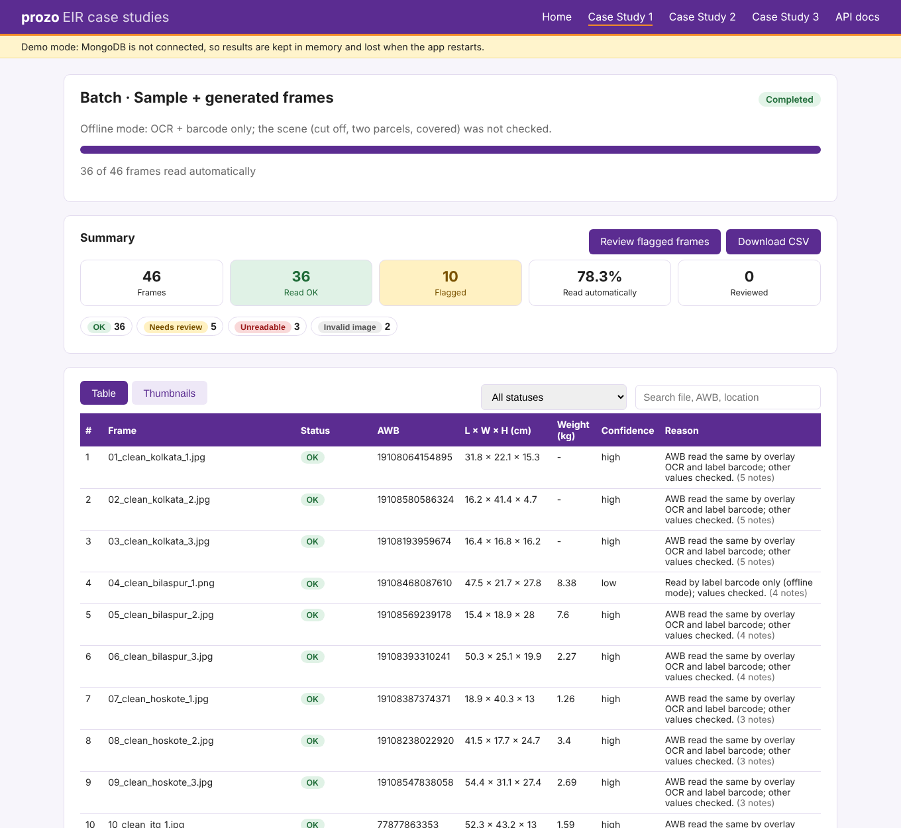
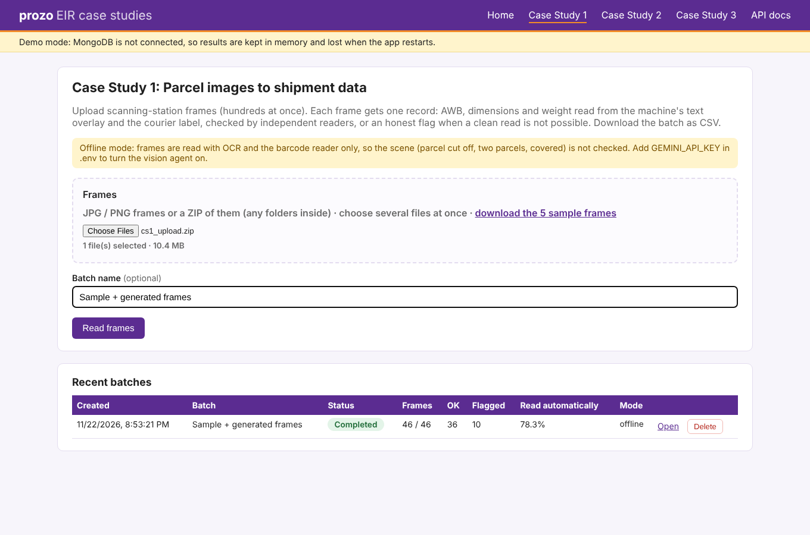
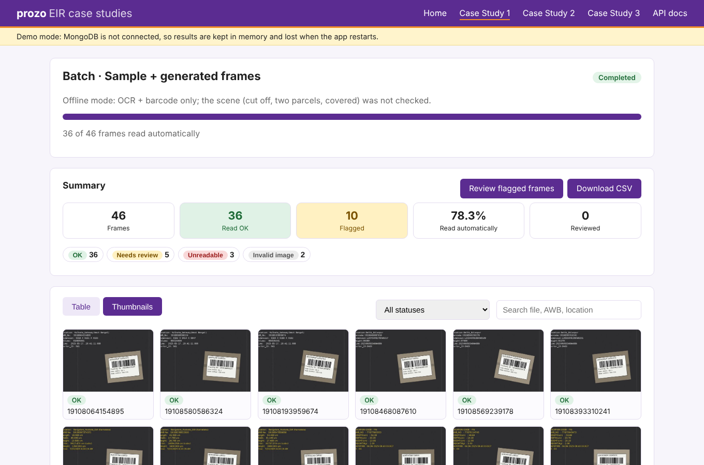
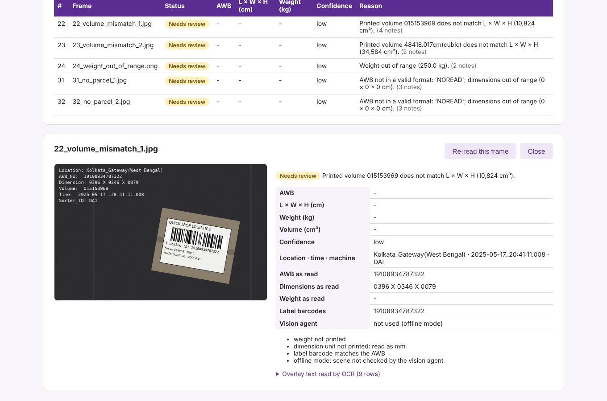
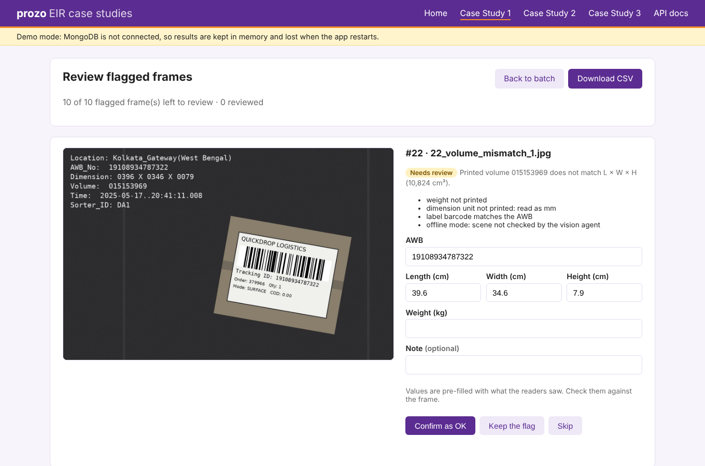
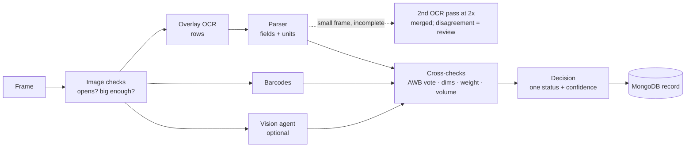

# Case Study 1: Parcel Images to Shipment Data

**Prozo EIR (Agentic AI): proof of concept.** Part of the same app as Case Studies 2 and 3 (repository overview in the root [README.md](../../README.md); plan and architecture in [CS1_Roadmap_and_Workflow.docx](CS1_Roadmap_and_Workflow.docx)).

Scanning stations photograph every parcel, and today a person types the AWB, weight and dimensions from each frame into a sheet. This module reads a batch of frames (hundreds at once) and returns **one record per frame**: the values, checked by independent readers, or an honest flag when a clean read is not possible. The batch downloads as CSV.

| | |
|---|---|
| **Pages** | `/case-study-1` (upload) · `/case-study-1/batches/{id}` (results) · `/case-study-1/batches/{id}/review` (fix flagged frames) |
| **Sample frames** | All 5 frames from the brief read exactly as the hand-made answer key (AWB, L × W × H, weight) |
| **Generated test set** | 41 frames covering every flag, the 5 sample layouts and 2 layouts never seen before: 41 / 41 statuses as expected, **0 wrong values in OK rows** (offline mode) |
| **Readers** | Offline OCR (RapidOCR) + offline barcode reader (zxing-cpp) + optional Gemini vision agent |
| **Tests** | 58 tests for Case Study 1 (163 in the repo) |
| **Cost** | Free. Works fully offline; the vision agent uses the Gemini free tier |



---

## 1. The problem, and what the sample frames showed

The brief asks for AWB / tracking number, weight and dimensions per image, a status flag when a clean read is not possible ("a wrong extraction is worse than an honest flag"), and a CSV of the whole batch. Prozo will also run it on its own images.

The 5 sample frames are **not phone photos of labels**: they are sorter / scanning-machine camera frames. The machine prints its own readings on the frame as a text overlay, and every site prints them differently:

| Frame | Overlay quirk | AWB | L × W × H (cm) | Weight (kg) |
|---|---|---|---|---|
| Dimensions and Image in different format | panel below the photo; L / W / H on separate coloured lines; A.W and V.W in grams | 19108610769602 | 39 × 28.5 × 29 | 2.32 |
| Dimensions has no LBH words, in mm | `Dimension: 0208 X 0148 X 0163`: no L / W / H words, mm, no unit printed; no weight | 19108610787894 | 20.8 × 14.8 × 16.3 | not printed |
| Half shipment captured | `Barcode:` instead of AWB; `L0213XH0148XW0178` (order L, H, W); `Weight:01190` with no unit | 19108610817924 | 21.3 × 17.8 × 14.8 | 1.19 |
| download (2) | separate Length / Width / Height with decimals; R.Vol; weight in gm; two labels on one parcel | 19108610906662 | 35.9 × 34.5 × 15.7 | 2.21 |
| f5dafc4b… | units inside the key: `LENGTH(cm)`, `WEIGHT(Kg)` | 77873372404 | 21.4 × 16.4 × 6.2 | 0.58 |

So the overlay is the main source, the courier label is a cross-check (and the fallback when there is no overlay), and the parser must not depend on one layout.

---

## 2. Quick start

Same app and setup as the other case studies:

```bash
source .venv/bin/activate && pip install -r requirements.txt     # adds rapidocr-onnxruntime and zxing-cpp
uvicorn app.main:app --reload                                     # or ./run.sh
# open http://localhost:8000/case-study-1
```

**Try it:** on the upload page click *download the 5 sample frames* and upload the ZIP, or upload any frames from `data/case_study_1/generated/`.

**Vision agent** (`.env`). It turns on automatically when `GEMINI_API_KEY` is set:

```
GEMINI_API_KEY=<your key>
CS1_USE_VISION=true                # false = offline mode (OCR + barcode only)
CS1_VISION_MODEL=gemini-3.5-flash  # gemini-2.0-flash was shut down by Google on 1 June 2026
CS1_VISION_PER_MINUTE=10           # stays inside the free-tier rate limit
CS1_WORKERS=2
```

If the model name is not available to your key, every frame shows *PROCESSING_ERROR* with the message "Set CS1_VISION_MODEL in .env to a current model". Pick one in Google AI Studio and use *Re-read failed frames*.

```bash
python scripts/case_study_1/generate_test_data.py   # rebuild the 41 generated frames + answer key (fixed seed)
python scripts/case_study_1/evaluate.py             # compare with both answer keys (uses vision if configured)
python scripts/case_study_1/evaluate.py --offline   # force offline mode
python -m pytest tests/case_study_1                 # Case Study 1 tests
```

---

## 3. Using the app

| Step | Screen |
|---|---|
| **1. Upload** frames or a ZIP (any folders inside; other files are listed as skipped). The banner says whether the vision agent is on. |  |
| **2. Batch page:** live progress, then counts per status (click a chip to filter), *read automatically* %, a table or thumbnail grid, search, **Download CSV**, **Re-read failed frames**. |  |
| **3. Frame detail:** click a row. The frame next to its values, the text exactly as read, label barcodes, the vision agent's answer, notes, and the OCR rows. |  |
| **4. Review:** flagged frames one at a time, values pre-filled with what the readers saw. *Confirm as OK* (with corrections), *Keep the flag*, or *Skip*. The automatic result is kept for audit. |  |

---

## 4. How it works

### 4.1 Three independent readers

| Reader | Reads | Why |
|---|---|---|
| **Overlay OCR** (offline, RapidOCR) | All text on the frame, grouped into rows, then parsed by a format-free parser into AWB, L / W / H, weight, volume, location, time, machine ID | The overlay is clean machine print, so local OCR is accurate, free and fast, with no internet or key |
| **Barcode reader** (offline, zxing-cpp) | Every barcode on the label (tried again at 2× when nothing decodes) | Exact when it decodes; an independent confirmation of the AWB |
| **Vision agent** (Gemini, optional) | Scene check (parcel count, cut off, covered, empty) plus its own copy of the overlay values and the label's tracking number, as JSON | Judges the scene, which OCR can't, and gives a second read of every value |

### 4.2 Pipeline for one frame (`app/case_study_1/pipeline.py`)



### 4.3 Decision rules (`decision.py`, `checks.py`)

- **AWB:** accepted when two independent readers read the same value (OCR, Gemini's overlay read, Gemini's label read, label barcode). Barcodes count only when they match another reader, because labels also carry order numbers. Any reader with a different value sends the frame to review.
- **Dimensions and weight:** OCR and Gemini must agree after unit conversion (±0.5 cm, ±0.02 kg), and values must be in range (1-250 cm, 0.01-100 kg).
- **Volume check:** where the overlay prints a volume, L × W × H must match it within 5% (in cm³, mm³ or m³). A mismatch means a digit or unit was misread. V.W is only used to confirm.
- **Units:** a printed unit wins. With none printed, zero-padded 4-digit numbers or values above 250 are mm, an integer weight of 100 or more is grams. Each inferred unit is noted.
- **Scene:** from the vision agent. No parcel, two parcels, cut off and covered each get their own flag.
- **Offline mode** (no key): a single read is accepted with *low* confidence and the note "scene not checked". Scene problems can't be seen, and the batch page says so.
- **Clean columns** (awb, length_cm, …) are filled only for OK frames. What was read is always kept in the `*_as_read` evidence columns.

### 4.4 Flags (one per frame; the first that applies wins)

| Status | Meaning |
|---|---|
| `INVALID_IMAGE` | not an image, corrupt, or smaller than 200 px |
| `NO_PARCEL` | no parcel in the frame (vision) |
| `MULTIPLE_PARCELS` | more than one parcel, so readings can't be tied to one (vision) |
| `PARCEL_PARTIAL` | parcel cut by the frame edge or half captured; machine readings may be wrong (vision) |
| `VIEW_OBSTRUCTED` | a hand or object covers the parcel or label (vision) |
| `UNREADABLE` | no machine readings and no readable label |
| `PROCESSING_ERROR` | the vision call failed after retries; evidence kept; re-run button |
| `NEEDS_REVIEW` | readable, but a check failed: readers disagree, value out of range, volume mismatch, invalid AWB |
| `OK` | AWB confirmed by two readers (or one in offline mode); every value checked |

Confidence on OK rows: **high** = confirmed by a label barcode as well; **medium** = two reads agree; **low** = single read (offline mode).

---

## 5. Output (CSV)

One row per frame, in upload order:

`image_file, status, status_reason, awb, length_cm, width_cm, height_cm, weight_kg, volume_cm3, location, scan_time, machine_id, awb_as_read, dimensions_as_read, weight_as_read, label_barcodes, units_inferred, confidence, reviewed, notes`

Dataset suffixes such as `_png.rf.WNrel…` are removed from file names. Results for both test sets are in `outputs/case_study_1/`.

---

## 6. Code structure

```
app/case_study_1/
├── rules.py           flag priority, overlay key aliases, units, ranges, tolerances  <- most changes go here
├── models.py          Status, Measure, Dimensions, OverlayFields, VisionResult, FrameResult
├── image_checks.py    opens the file (EXIF rotation), size, brightness / sharpness hints, thumbnail
├── overlay_ocr.py     RapidOCR, boxes -> rows (left to right), optional 2x pass
├── overlay_parser.py  format-free "key: value" parser, dimension strings, unit inference, merging two passes
├── barcode.py         zxing-cpp, with a 2x retry
├── vision.py          Gemini prompt + JSON schema, rate limiter, retries, answer parsing
├── checks.py          AWB vote, dimension / weight agreement, ranges, volume check
├── decision.py        status by priority, confidence, notes, clean vs evidence columns
├── pipeline.py        one frame end to end (used by the app, the scripts and the tests)
├── export.py          CSV columns
├── repository.py      MongoDB: cs1_batches, cs1_records
├── service.py         batches, ZIP unpacking, worker pool, resume after restart, duplicates, review, re-run
├── api.py             /api/cs1 endpoints
└── pages.py           /case-study-1 pages
app/templates/case_study_1/   index.html · batch.html · review.html
app/static/js/case_study_1/   upload.js · batch.js · review.js · frames.js (shared helpers)
data/case_study_1/            sample/ (5 frames + answer_key.csv) · generated/ (41 frames + answer_key.csv)
scripts/case_study_1/         generate_test_data.py · evaluate.py
outputs/case_study_1/         CSV results for both test sets
tests/case_study_1/           test_overlay_parser · test_decision · test_vision · test_pipeline · test_api
docs/case_study_1/            this README, CS1_Roadmap_and_Workflow.docx, screenshots/
```

The core (parser, checks, decision, pipeline) has no FastAPI or MongoDB code, so the web app, `evaluate.py` and the tests run exactly the same logic.

### MongoDB

| Collection | One document per | Holds |
|---|---|---|
| `cs1_batches` | upload | label, total, skipped files, vision mode + model, status, timestamps |
| `cs1_records` | frame | stored path, state (pending / done), status, values, evidence, notes, every reader's raw output, review (with the automatic result under `auto`) |

### API (`/api/cs1`, Swagger at `/docs`)

| Method | Path | Purpose |
|---|---|---|
| POST | `/batches` | upload `files` (images and / or ZIPs) + optional `label` → batch id |
| GET | `/batches`, `/batches/{id}` | list, status + counts |
| GET | `/batches/{id}/records?status=&flagged=` | records |
| GET | `/batches/{id}/csv` | CSV download |
| POST | `/batches/{id}/rerun` | re-read every PROCESSING_ERROR frame |
| DELETE | `/batches/{id}` | delete batch, frames and records |
| GET / PATCH | `/records/{id}` | detail · review (`confirm` with values, or `keep_flag`) |
| POST | `/records/{id}/rerun` | re-read one frame |
| GET | `/records/{id}/image`, `/thumbnail` | the frame |
| GET | `/samples/sample-frames.zip` | the 5 sample frames |

---

## 7. Test data and results

| Set | What | Result (offline mode) |
|---|---|---|
| `data/case_study_1/sample/` | the brief's 5 frames, hand-made answer key | 5 / 5, all values exact; the half-captured frame reads OK offline, and the vision agent flags it PARCEL_PARTIAL |
| `data/case_study_1/generated/` | 41 frames: 21 clean (7 layouts incl. 2 unseen), volume mismatch, 250 kg weight, half frames, two parcels, a hand over the label, empty belt with NOREAD, label-only, blurred, dark, duplicate AWB, corrupt file, tiny image | 41 / 41 statuses as expected, 0 wrong values, 0 missing values |

Each answer key has `expected_status` (with the vision agent) and `expected_status_offline`. The 6 scene-problem frames are OK offline: the offline readers can't see the scene, and `evaluate.py` reports them separately.

**Measured while building:** the first evaluation run found real gaps, and each was fixed in general code, not for one file:

- an OCR glitch ("AWB_No:1 1910…"): the one valid token is now picked, and tokens are never joined;
- a full-width bracket "（" returned by OCR: text is now Unicode-normalised;
- single-letter keys ("L:") detected at a low score: key-only boxes are now kept, since they carry no digits;
- a key missed on small frames: a second OCR pass at 2×, where any disagreement between passes goes to review;
- label text "Tracking ID" read as the machine "ID": generic keys are now protected;
- RapidOCR reading red text badly because it expects BGR channel order: fixed.

**Not yet measured:** the vision agent on real frames (Gemini can't be reached from the build environment). Its client, retries and answer parsing are tested with recorded responses, and the decision rules with hand-written vision answers. Run `python scripts/case_study_1/evaluate.py` with a key to measure it.

---

## 8. Error handling

| Problem | Behaviour |
|---|---|
| Not an image / corrupt / tiny | a row with `INVALID_IMAGE`; the batch continues |
| ZIP with folders, `__MACOSX`, other files | images from every folder; other files listed as skipped |
| Upload with no images, broken ZIP, over `CS1_MAX_UPLOAD_MB` | rejected at once with a clear message |
| Gemini rate limit / busy | shared rate limiter + 4 attempts with back-off; then `PROCESSING_ERROR` with the OCR evidence kept |
| Gemini model retired / not available | clear message naming `CS1_VISION_MODEL` |
| Gemini rejects the JSON schema | retried once without the schema (plain JSON) |
| Unexpected error on one frame | that frame is `PROCESSING_ERROR` with a reference id; others continue |
| App restarted mid-batch | the batch resumes on start; finished frames are not re-read |
| Database connection drops (network / TLS) | saving a frame's result is retried; API answers 503 "try again"; the batch page keeps polling |

---

## 9. Design decisions

| Decision | Why |
|---|---|
| Overlay first, label second | The machine's measured values are on every sample frame; the label holds only the AWB |
| Offline OCR as the main reader | Free, fast, no data leaves the machine, works without a key; accurate on machine print |
| Two reads must agree | The brief values precision over recall; a single misread digit is caught by the second reader |
| Format-free parser + aliases | 5 frames came in 5 layouts; Prozo's own images will bring more. A new layout is usually one alias |
| Clean columns only for OK | Operations can trust any filled `awb`; evidence is still there for every frame |
| Review screen keeps the automatic result | Audit trail; "read automatically" % is measured before corrections |

---

## 10. Known limitations and next steps

- Without the vision agent, scene problems (half frame, two parcels, hand) are not detected. Offline mode says so on every page and note.
- Units with nothing printed are inferred by rule. Prozo should confirm per machine (for example "0208 X 0148 X 0163" = mm, "01190" = grams).
- OCR keeps text as printed: an OCR slip in a non-required field (sorter "DA1" read as "DAl") stays in the evidence columns.
- About 1-3 seconds per frame on a laptop CPU (OCR), plus the vision call. 300 frames take a few minutes with 2 workers.
- Next: per-machine profiles learned from reviewed frames; Gemini batch API for large volumes; send reviewed corrections back to the main system automatically.

---

## 11. Interview guide

**3-minute demo:**

1. Upload the 5 sample frames as a ZIP. Show the live progress.
2. Open "Dimensions has no LBH words": 20.8 × 14.8 × 16.3 cm, "unit inferred: mm", volume check passed (2.3% apart).
3. Open f5dafc4b: OCR and the label barcode agree, so confidence is high.
4. Upload the generated set. Filter *Needs review*: the volume mismatch and the 250 kg weight are caught.
5. Review one frame, then download the CSV.
6. Show `evaluate.py`: 0 wrong values in OK rows.

**Talking points:**

- "The sample frames are machine frames, so I read the machine's own numbers and use the label as a check."
- "Two independent reads must agree before a value reaches the CSV; otherwise it's an honest flag."
- "It works offline; the AI adds the scene check and a second opinion, not the numbers."

**Live-change cheatsheet:**

| Ask | Change |
|---|---|
| Support a new overlay key ("Consignment No") | `AWB_KEY_ALIASES` in `rules.py` |
| Volume tolerance 5% → 3% | `VOLUME_TOLERANCE` |
| Fill clean columns on flagged frames too | `FLAGGED_ROWS_KEEP_VALUES = True` |
| Add a flag (e.g. DAMAGED_PARCEL) | `Status` in `models.py`, `STATUS_PRIORITY`, one field in the vision schema + `_scene_status()` |
| Add a CSV column | `CSV_COLUMNS` in `export.py` |
| Different Gemini model | `CS1_VISION_MODEL` in `.env` |

**Questions for Prozo:** is the overlay the source of truth; unit confirmation per machine; actual vs volumetric weight (on sample 1, V.W = L × W × H); should machine readings on flagged frames be passed on; are location, time and machine ID wanted in the CSV.
