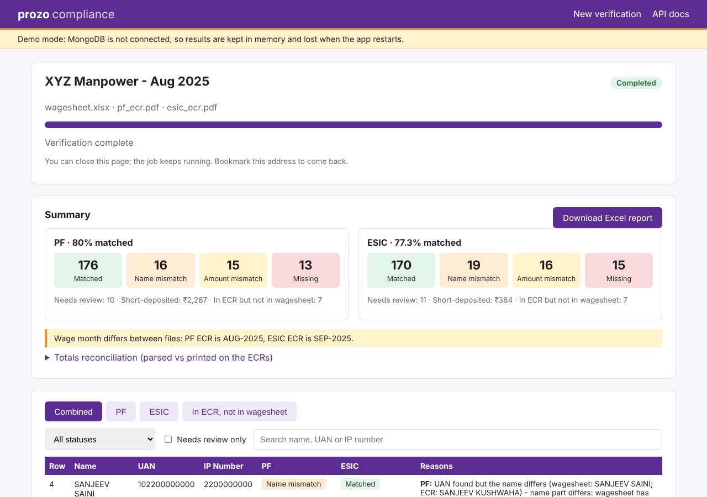
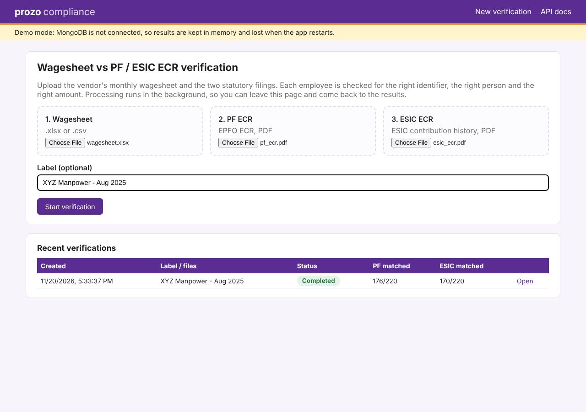
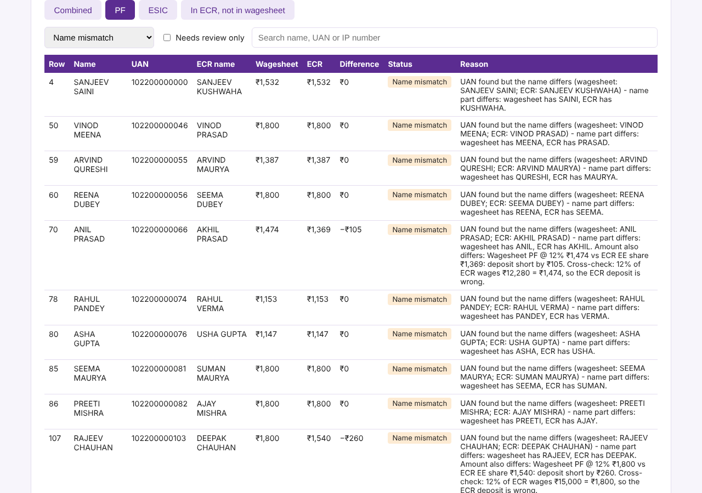
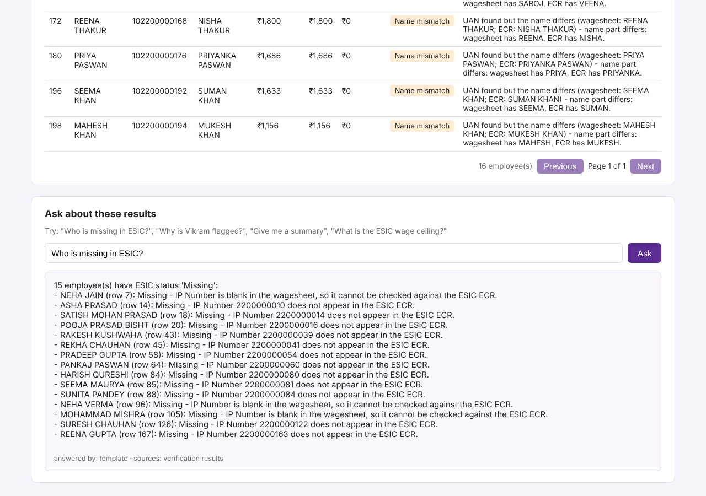
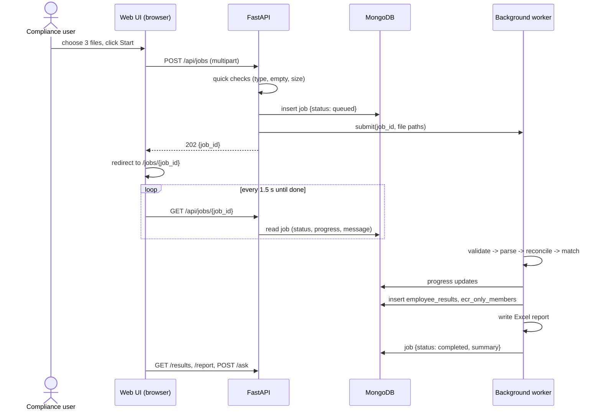
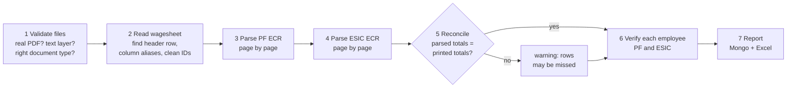
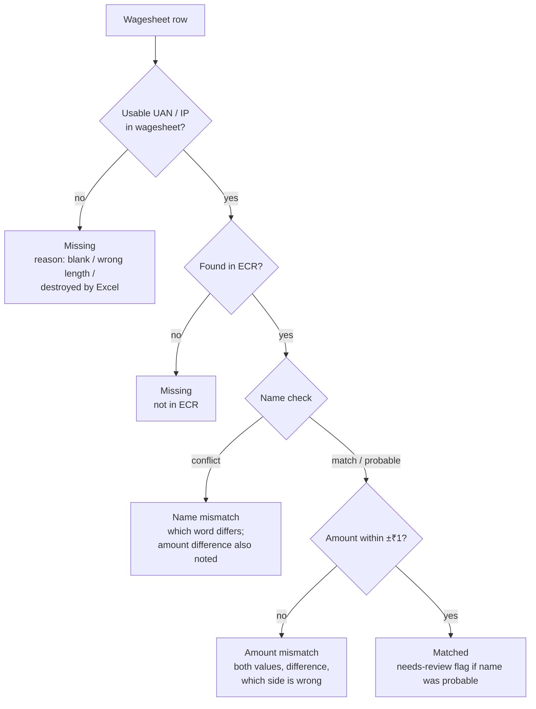
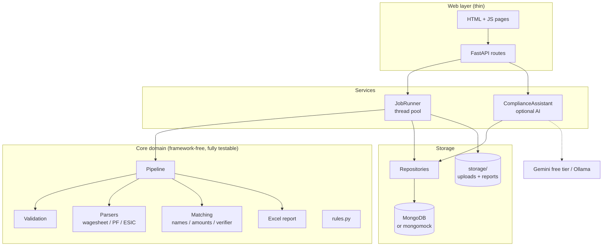
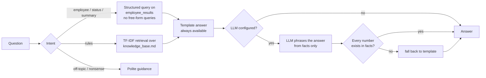

# Wagesheet vs PF / ESIC ECR Compliance Verification

> This repository holds **two case studies in one app** (home page `/` links to both):
> **Case Study 2**, PF / ESIC verification, is documented in this file.
> **Case Study 3**, the daily FC P&L monitor & alert digest, is documented in **[docs/case_study_3/README.md](../case_study_3/README.md)**. The repository overview is the root [README.md](../../README.md).

**Prozo EIR (Agentic AI) case study 2: proof of concept**

This web app checks a vendor's monthly wagesheet against the two statutory filings, the **EPFO PF ECR** and the **ESIC ECR**. For each employee it confirms that the right identifier, the right person and the right amount were deposited. Each employee gets a verdict with a plain-language reason, and the whole result downloads as an Excel report.

| | |
|---|---|
| **Stack** | Python 3.9+ · FastAPI · MongoDB (with an in-memory fallback) · pdfplumber · openpyxl · vanilla JS |
| **Sample data** | Reproduces the hand-checked answer key exactly (PF 9/1/1/1, ESIC 8/1/1/2) |
| **Synthetic data** | 100% verdict accuracy on 3,544 PF/ESIC checks across 3 generated sets, up to 1,500 employees and 50-page ECRs |
| **Tests** | 62 automated tests for Case Study 2, plus 6 page tests (104 in the repo including Case Study 3) |
| **Cost** | Free. No paid API is needed. AI is optional (Gemini free tier or local Ollama). |



---

## Contents

1. [The problem](#1-the-problem)
2. [Quick start (under 15 minutes)](#2-quick-start-under-15-minutes)
3. [Using the app](#3-using-the-app)
4. [How it works: end-to-end workflow](#4-how-it-works-end-to-end-workflow)
5. [Architecture](#5-architecture)
6. [Code structure](#6-code-structure)
7. [Verification rules](#7-verification-rules)
8. [How the PDFs are read](#8-how-the-pdfs-are-read)
9. [MongoDB data model](#9-mongodb-data-model)
10. [API reference](#10-api-reference)
11. [Excel report](#11-excel-report)
12. [Optional AI assistant (RAG)](#12-optional-ai-assistant-rag)
13. [Test data and evaluation](#13-test-data-and-evaluation)
14. [Error handling](#14-error-handling)
15. [Design decisions and trade-offs](#15-design-decisions-and-trade-offs)
16. [Known limitations](#16-known-limitations)
17. [What I would do next](#17-what-i-would-do-next)
18. [Interview guide](#18-interview-guide)

---

## 1. The problem

Vendor agencies supply contract workers to Prozo's fulfilment centres. Each month the vendor deducts:

- **PF at 12%** of EPF wages, which must be deposited with EPFO and listed in the **PF ECR** by **UAN** (12 digits)
- **ESIC at 0.75%** of gross wages, which must be deposited with ESIC and listed in the **ESIC ECR** by **IP Number** (10 digits)

If the vendor deducts the money but doesn't deposit it, **Prozo, as the principal employer, is liable**. Today the compliance team matches hundreds of rows across three documents by hand.

**Inputs:** a wagesheet (Excel), a PF ECR (PDF) and an ESIC ECR (PDF).
**Output:** for each employee, separately for PF and ESIC, one of the following, plus summary counts:

| Status | Meaning |
|---|---|
| **Matched** | ID found, same person, amount within ₹1 |
| **Name mismatch** | ID found, but the name belongs to a different person |
| **Amount mismatch** | ID and name OK, amount differs; both values and the difference are shown |
| **Missing** | ID not in the ECR, or no usable ID in the wagesheet |

The hard part is **name tolerance**: catching genuine mismatches without flagging harmless spelling differences.

---

## 2. Quick start (under 15 minutes)

### Option A: Docker (app + real MongoDB)

```bash
docker compose up --build
# open http://localhost:8000
```

### Option B: Local Python (MongoDB optional)

```bash
python3 -m venv .venv && source .venv/bin/activate
pip install -r requirements.txt
uvicorn app.main:app --reload          # or ./run.sh
# open http://localhost:8000
```

If MongoDB is running on `localhost:27017` it is used. Otherwise the app starts in **demo mode** with an in-memory MongoDB (`mongomock`) and shows a banner saying so. Copy `.env.example` to change any setting.

### Try it

The home page (`/`) links to each case study. Open **Case Study 2** (`/case-study-2`) and upload the three files from `data/case_study_2/sample/`, or any folder under `data/case_study_2/synthetic/`. **Case Study 3** (`/case-study-3`) is documented in [its README](../case_study_3/README.md).

| Page | Address |
|---|---|
| Home (links to both case studies) | `/` |
| Case Study 2: upload | `/case-study-2` |
| Case Study 2: results of one job | `/case-study-2/jobs/{job_id}` (old `/jobs/{job_id}` links redirect here) |
| Case Study 3: upload, results, dashboard | `/case-study-3`, `/case-study-3/runs/{id}`, `/case-study-3/dashboard` |

### Command line, tests and evaluation

```bash
# verify without the web app
python scripts/case_study_2/verify_cli.py --wagesheet data/case_study_2/sample/Sample_Wagesheet_Aug25.xlsx \
    --pf "data/case_study_2/sample/PF ECR AUG-25 SAMPLE.pdf" --esic "data/case_study_2/sample/ESIC ECR AUG-25 SAMPLE.pdf" --out report.xlsx

python -m pytest tests/case_study_2       # this case study's tests (python -m pytest runs all 104)
python scripts/case_study_2/generate_test_data.py   # regenerate synthetic sets (deterministic seeds)
python scripts/case_study_2/evaluate.py             # accuracy against every answer key + Excel outputs
```

---

## 3. Using the app

| Step | Screen |
|---|---|
| **1. Upload.** From the home page open Case Study 2, then upload the wagesheet, PF ECR and ESIC ECR, with an optional label. Bad files are rejected straight away with a clear message. |  |
| **2. Progress.** The job runs in the background ("Reading PF ECR: page 34 of 210"). You can close the tab; the job page URL works later, and recent jobs are listed on the home page. | |
| **3. Summary.** PF and ESIC counts (click a count to filter), match rate, rupees short-deposited, warnings and the totals reconciliation. |  |
| **4. Drill down.** Combined, PF, ESIC and *In ECR, not in wagesheet* tabs; filter by status or needs-review; search by name, UAN or IP number. Every row shows both values and the reason. |  |
| **5. Download** the Excel report (6 sheets). | |
| **6. Ask** in plain language: "Who is missing in ESIC?", "Why is Vikram flagged?", "What is the ESIC wage ceiling?" |  |

---

## 4. How it works: end-to-end workflow

### 4.1 Request flow



### 4.2 Processing pipeline (`app/case_study_2/pipeline.py`)



| # | Stage | What happens | Code |
|---|---|---|---|
| 1 | Validate | `%PDF` signature, opens, has text (not a scan), looks like a PF / ESIC ECR (catches swapped files) | `validation.py` |
| 2 | Wagesheet | Header row found in the first 10 rows; vendor header names mapped through aliases; IDs cleaned (Excel floats, spaces, scientific notation detected) | `parsers/wagesheet.py` |
| 3–4 | ECRs | Word-position table reconstruction, ID-anchored rows, wrapped names joined, footers logged | `parsers/pdf_table.py`, `pf_ecr.py`, `esic_ecr.py` |
| 5 | Reconcile | Member count and EE total (PF), IP contribution and wage totals (ESIC) vs the ECR header | `pipeline.py` |
| 6 | Verify | Join on UAN / IP, then name rules, then amount ±₹1, then verdict and reason; plus duplicates and ECR-only members | `matching/verifier.py` |
| 7 | Report | Per-employee docs in MongoDB, summary on the job, 6-sheet Excel | `repository.py`, `report.py` |

### 4.3 Decision for one employee and one check



---

## 5. Architecture



**Principles**

- **Core logic has no framework code.** The parsers, matching, pipeline and report in `app/case_study_2/` don't import FastAPI or MongoDB, so the CLI, the web app and the tests all run the same pipeline.
- **One file holds the business rules.** Rates, tolerance, column aliases and name settings live in `app/case_study_2/rules.py`.
- **One folder per case study.** Everything for Case Study 2 is in `app/case_study_2/`; code used by both case studies is in `app/shared/`.
- **Thin routes.** Routes validate input, call a service and shape the response.
- **A composition root.** `app/container.py` builds and wires everything once; tests build their own container with an in-memory DB.
- **Honest output.** Every verdict has a reason, totals are reconciled, and skipped PDF lines are logged.

---

## 6. Code structure

```
prozo-compliance-poc/
├── app/
│   ├── main.py                  FastAPI app factory: registers each case study's API + pages
│   ├── config.py                infrastructure settings from env (Mongo, storage, LLM, SMTP)
│   ├── container.py             composition root: builds repositories, runners, assistant
│   ├── shared/                  used by both case studies
│   │   ├── db.py                MongoDB connection (real server or in-memory fallback)
│   │   ├── errors.py            InputError (user-facing messages)
│   │   ├── llm.py               none / Gemini / Ollama clients
│   │   └── pages.py             home page, page rendering, asset versioning
│   ├── case_study_2/            <- everything for this case study
│   │   ├── rules.py             rates, tolerance, ID lengths, titles, aliases, column names
│   │   ├── models.py            dataclasses: WagesheetRow, PfEcrMember, CheckResult, Report...
│   │   ├── validation.py        upload + document checks
│   │   ├── pipeline.py          end-to-end orchestration + totals reconciliation
│   │   ├── parsers/
│   │   │   ├── pdf_table.py     generic word-position table reader (headers, columns, wraps)
│   │   │   ├── pf_ecr.py        PF ECR column spec + header totals
│   │   │   ├── esic_ecr.py      ESIC ECR column spec + header totals
│   │   │   └── wagesheet.py     Excel/CSV reader with header detection + aliases
│   │   ├── matching/
│   │   │   ├── normalize.py     ID cleaning, amount parsing, name tokens, phonetic keys
│   │   │   ├── names.py         word-by-word name matcher (MATCH / PROBABLE / CONFLICT)
│   │   │   ├── amounts.py       tolerance + statutory rounding
│   │   │   └── verifier.py      PF/ESIC checks via one CheckSpec each
│   │   ├── report.py            6-sheet formatted Excel report
│   │   ├── repository.py        MongoDB: JobRepository, ResultRepository (+ indexes)
│   │   ├── job_runner.py        background execution, progress, error -> message
│   │   ├── assistant/           Ask (RAG): assistant.py, retriever.py, knowledge_base.md
│   │   ├── api.py               /api/jobs: upload, status, results, report, ask
│   │   └── pages.py             /case-study-2 and /case-study-2/jobs/{id}
│   ├── case_study_3/            Daily FC P&L monitor (same layout, see its README)
│   ├── templates/               shared/ (base, home) · case_study_2/ · case_study_3/
│   └── static/                  css/style.css · js/shared/ · js/case_study_2/ · js/case_study_3/
├── data/case_study_2/
│   ├── sample/                  the 3 provided files + hand-made expected_results.csv
│   └── synthetic/               3 generated sets + bad_inputs/ (see section 13)
├── outputs/case_study_2/        Excel reports produced from every test set
├── scripts/case_study_2/
│   ├── generate_test_data.py    synthetic wagesheets + ECR PDFs + answer keys
│   ├── evaluate.py              accuracy vs answer keys
│   └── verify_cli.py            run a verification from the terminal
├── tests/case_study_2/          pytest suite for this case study (tests/shared/ covers the pages)
├── docs/case_study_2/           this README, roadmap document, screenshots/
├── Dockerfile · docker-compose.yml · run.sh · requirements.txt · .env.example
└── README.md                    repository overview
```

### Where to change what

| Change | File |
|---|---|
| Amount tolerance, rates | `case_study_2/rules.py` → `AMOUNT_TOLERANCE_RUPEES`, `PF_EMPLOYEE_RATE` |
| Accept a new vendor column header | `case_study_2/rules.py` → `WAGESHEET_COLUMN_ALIASES` |
| Stricter names (no initials / vowel variants) | `case_study_2/rules.py` → `ALLOW_INITIALS`, `ALLOW_VOWEL_VARIANTS` |
| New spelling rule (e.g. x = ksh) | `case_study_2/matching/normalize.py` → `_PHONETIC_RULES` |
| New status | `case_study_2/models.py` → `Status` + rule in `verifier.py` + colour in `report.py` / CSS |
| A different ECR layout | `case_study_2/parsers/pf_ecr.py` → `PF_TABLE` column spec |
| A third statutory check (e.g. LWF) | add a `CheckSpec` in `verifier.py` |

---

## 7. Verification rules

### 7.1 Identifiers

- Wagesheet IDs are read **as raw cell values** with openpyxl, not pandas, so Excel damage can be detected:
  - `999912340001` (number), `999912340001.0` (float) and `"9999 1234 0001"` are all accepted
  - `"9.99912E+11"` means Excel has **destroyed the digits**. The result is Missing with the reason "converted to scientific notation by Excel"
  - wrong length, letters or a blank cell give Missing, with the exact reason
- Duplicate IDs in the wagesheet or the ECR raise a warning, and the affected rows are flagged "needs review".

### 7.2 Names: word by word, not one fuzzy score

Whole-string fuzzy similarity can't separate typos from different people:

| Pair | Similarity | Truth |
|---|---|---|
| SUNITA DEVI / SUNEETA DEVI | 87 | same person |
| RENU SHARMA / REKHA SHARMA | 78 | **different** person |
| DINESH PRASAD / DEVENDRA PRASAD | 64 | **different** person |
| KUMAR ANIL / ANIL KUMAR | 50 | same person |

So names are cleaned (case, punctuation, titles Mr/Smt/Shri, aliases MOHD→MOHAMMAD), split into words, and the words are paired:

| Word match | Rule | Example | Effect |
|---|---|---|---|
| Exact | identical | RAJESH = RAJESH | match |
| Phonetic | same after transliteration rules (ee→i, oo→u, sh→s, th→t, w→v, y→i, x→ks, double letters) | SUNEETA ~ SUNITA, PRASHAD ~ PRASAD, LAXMI ~ LAKSHMI | match |
| Initial | one-letter word is the initial | R ~ RAJESH | **probable** (needs review) |
| Vowel variant | same consonants and same first letter | KIRAN ~ KARAN | **probable** (needs review) |
| None | anything else | RAKESH × RAMESH, REKHA × RENU, ASHA × USHA | conflict |

**Name-level decision**

- **Match:** every word of the shorter name pairs strongly, and nothing is left over. Word order and missing spaces are handled.
- **Probable:** every word pairs, but at least one pair is an initial or vowel variant, or the longer name has an extra part (ANIL KUMAR / ANIL KUMAR SINGH). The status stays **Matched** with a **needs review** flag.
- **Conflict:** a word of the shorter name has no partner, so the status is **Name mismatch**. The reason says which word differs.

> **Tolerance in one sentence:** spelling, spacing, word order, titles and initials are tolerated; a different given name or surname is never tolerated, even when the surname matches.

The PF ECR carries **two names** (as per ECR and as per the UAN repository). The better result is used, and if the two ECR names disagree with each other, that is flagged too.

### 7.3 Amounts

- Tolerance is **±₹1**, because PF rounds to the nearest rupee and ESIC rounds **up** (0.75% × 13,520 = 101.40 → 102).
- `difference = ECR − wagesheet`, so a negative number means a short deposit.
- **Cross-check:** the ECR includes wages, so the app recalculates 12% / 0.75% and says *which side is wrong*. For example: *"12% of ECR wages ₹13,780 = ₹1,654, so the ECR deposit is wrong."*

### 7.4 Priority

Missing → Name mismatch → Amount mismatch → Matched. When the name is wrong *and* the amount differs, the status is Name mismatch (a wrong person is the bigger risk) and the amount difference is written in the reason.

---

## 8. How the PDFs are read

`pdfplumber.extract_tables()` returns **nothing** for these ECRs because they have no ruling lines. So `case_study_2/parsers/pdf_table.py` rebuilds the table from word coordinates:

1. Group words into visual lines (same `top` within 3 pt).
2. Find the **header line** by its keywords (PF: `UAN`, `EE`, `ER`) and record where each column starts, by matching header phrases left to right (`Name as per ECR`, `UAN Repository`, `Wages` ×4, …).
3. Assign each word to the column whose start is at or left of it.
4. A line whose ID column holds a full 12-digit UAN (or 10-digit IP) **starts a row**.
5. A short, letters-only line within 16 pt below a row, sitting only in name columns, is a **wrapped name** and is appended.
6. Anything else (footers, page numbers, repeated headers) is **logged** in the Parse Log, never silently dropped.
7. The column layout is **reused on pages without a header**. Pages are processed one at a time, with progress reported for each.

Each document type is just a `TableSpec` (column header words, ID pattern, wrap columns), so a new layout means a new spec, not new code.

**Safety net:** the parsed member count and money totals are compared with the totals printed on the ECR. A gap is shown as a warning on the Summary.

---

## 9. MongoDB data model

**Why MongoDB:** job and result documents are naturally nested (an employee with a PF check and an ESIC check), ECR layouts and metadata vary by vendor and month, and it's schema-flexible for the next tools on the roadmap (vendor portal, compliance calendar).

| Collection | One document per | Key fields | Indexes |
|---|---|---|---|
| `jobs` | verification run | `_id` (job id), `status`, `stage`, `progress`, `message`, `input_files`, `summary`, `warnings`, `reconciliation`, `metadata`, `error`, timestamps | `created_at`, `status` |
| `employee_results` | employee per job | `job_id`, `row_number`, `name`, `uan`, `ip_number`, `pf{…}`, `esic{…}` | `(job_id,row_number)`, `(job_id,pf.status)`, `(job_id,esic.status)` |
| `ecr_only_members` | ECR member not on wagesheet | `job_id`, `check`, `identifier`, `name`, `amount`, `page` | `job_id` |

Example `employee_results` document:

```json
{
  "job_id": "3645e905c63b", "row_number": 12, "name": "VIKRAM THAKUR",
  "uan": "999912340011", "ip_number": "9912340011", "agency": "Sample Staffing Pvt. Ltd.", "state": "Bihar",
  "pf": {
    "status": "Amount mismatch", "needs_review": false, "identifier": "999912340011",
    "ecr_name": "VIKRAM THAKUR", "wagesheet_amount": 1654.0, "ecr_amount": 1354.0, "difference": -300.0,
    "expected_from_ecr_wages": 1654.0, "name_verdict": "match", "ecr_page": 1,
    "reason": "Wagesheet PF @ 12% ₹1,654 vs ECR EE share ₹1,354: deposit short by ₹300. Cross-check: 12% of ECR wages ₹13,780 = ₹1,654, so the ECR deposit is wrong."
  },
  "esic": { "status": "Matched", "reason": "IP Number, name and amount match.", "...": "..." }
}
```

Results are stored **one document per employee**, not inside the job, so large jobs stay far below the 16 MB document limit and filtering and pagination happen on the server. Uploaded files and reports are kept on disk under `storage/`; GridFS or S3 would be the production choice.

If the server restarts, jobs that were still running are marked failed with an honest message (`fail_interrupted_jobs`).

---

## 10. API reference

Interactive docs are at **`/docs`** (Swagger).

| Method | Path | Purpose |
|---|---|---|
| `POST` | `/api/jobs` | multipart `wagesheet`, `pf_ecr`, `esic_ecr`, `label?` → `202 {job_id}` |
| `GET` | `/api/jobs` | recent jobs |
| `GET` | `/api/jobs/{id}` | status, progress %, message, summary, warnings, reconciliation |
| `GET` | `/api/jobs/{id}/results` | `check=pf\|esic`, `status`, `q` (name/UAN/IP), `needs_review`, `page`, `page_size` |
| `GET` | `/api/jobs/{id}/ecr-only` | members in an ECR but not on the wagesheet |
| `GET` | `/api/jobs/{id}/report` | Excel download |
| `POST` | `/api/jobs/{id}/ask` | `{"question": "..."}` → `{answer, intent, mode, sources}` |
| `GET` | `/health` | `{"status":"ok","database":"mongodb\|in-memory"}` |

Input errors return `400 {"detail": "<plain-language message>", "field": "<upload slot>"}`.

---

## 11. Excel report

| Sheet | Contents |
|---|---|
| **Summary** | establishment, wage month, files; counts per status for PF and ESIC; needs-review; match rate; ₹ short-deposited; ECR-only counts; totals reconciliation; warnings |
| **PF Results** | row, name, agency, state, UAN, ECR name, wagesheet amount, ECR EE, difference, status (colour-coded), needs review, reason, ECR page |
| **ESIC Results** | the same for IP Number / IP contribution |
| **Combined** | PF and ESIC side by side, plus an *Action needed* column |
| **ECR Only** | people filed by the vendor who aren't on the wagesheet |
| **Parse Log** | pages, rows parsed, wrapped name lines, value errors, every skipped line |

Reports generated from all test sets are in `outputs/case_study_2/`.

---

## 12. Optional AI assistant (RAG)

**Position:** the verdicts are **deterministic code**, not AI. Matching IDs and rupees is an exact task with legal consequences, and retrieval or LLMs find *similar* things, not *equal* ones. AI is used where it helps a person: answering questions and explaining results.



- **Retrieval:** results questions use safe structured filters; rules questions use the top passages from `app/case_study_2/assistant/knowledge_base.md` (rates, ceilings, rounding, due dates, principal-employer liability, what each status means and what to do).
- **Generation (optional):** `LLM_PROVIDER=gemini` with a free `GEMINI_API_KEY`, or `LLM_PROVIDER=ollama` for a local model. With the default `none`, the template answers are used.
- **Guardrails:** the LLM only sees the retrieved facts; any number it states must appear in them, otherwise the template answer is shown. It can't change a verdict. Nonsense questions get guidance instead of a guess.
- **Swap points:** the TF-IDF retriever can be replaced by embeddings (sentence-transformers + FAISS) inside `retriever.py` without touching anything else.

---

## 13. Test data and evaluation

`scripts/case_study_2/generate_test_data.py` builds realistic sets with **deterministic seeds**. Each employee gets an independent scenario for PF and for ESIC, with a known expected status written to `expected_results.csv`.

| Scenario | Expected | Example |
|---|---|---|
| clean, spelling variant, word order, title in ECR, ±₹1 rounding | Matched | SUNITA → SUNEETA, "MR. ANIL KUMAR" |
| initial in ECR, extra name part | Matched (needs review) | R KUMAR, ANIL KUMAR SINGH |
| first-name conflict, surname conflict | Name mismatch | REKHA → RENU, RAKESH → RAMESH |
| name + amount wrong | Name mismatch | |
| short deposit, wagesheet figure wrong | Amount mismatch | |
| not in ECR, blank ID, Excel scientific-notation UAN | Missing | `1.02200E+11` |

| Set | What it stresses | Employees | Pages (PF/ESIC) |
|---|---|---|---|
| `sample` | the provided files (hand-made answer key) | 12 | 1 / 1 |
| `set_01_name_variants` | heavy name variation: no false alarms | 40 | 2 / 2 |
| `set_02_messy_vendor_file` | vendor headers + title row, int/float/spaced/scientific IDs, ECR-only members, wage-month mismatch | 220 | 9 / 8 |
| `set_03_large_scale` | 1,500 employees; continuation pages **without** a repeated header; wrapped names | 1,500 | 50 / 48 |
| `bad_inputs/` | corrupt PDF, renamed Excel, scanned PDF, invoice instead of ECR, wrong columns, header-only sheet | – | – |

**Results** (`python scripts/case_study_2/evaluate.py`):

```
Test set                       Employees            Pages  Accuracy  Time(s)  Totals
sample                                12    PF 1 / ESIC 1    100.0%      0.1  OK
set_01_name_variants                  40    PF 2 / ESIC 2    100.0%     0.24  OK
set_02_messy_vendor_file             220    PF 9 / ESIC 8    100.0%     0.85  OK
    ! Wage month differs between files: PF ECR is AUG-2025, ESIC ECR is SEP-2025.   <- intended
set_03_large_scale                  1500  PF 50 / ESIC 48    100.0%     5.13  OK
```

> **The evaluation caught a real gap.** The first run scored 99.93% on the large set: *LAXMI* vs *LAKSHMI* was reported as a name mismatch. One transliteration rule (`x → ks`) fixed it, and a test now pins it. This is the loop I'd use in production: every false alarm reported by the compliance team becomes a test case.

**Honest caveat:** the synthetic data was generated by me, so it tests the rules I thought of. That's why the provided sample is checked against a hand-made answer key, and why real ECRs from Prozo are the most valuable next test.

---

## 14. Error handling

| Bad input | Where caught | Message |
|---|---|---|
| Missing file / wrong extension / empty / too large | API, immediately (400) | "The wagesheet must be one of .csv, .xlsm, .xlsx (got '.txt')." |
| Renamed file (Excel saved as .pdf) | job validation | "The PF ECR is not a real PDF file (it may be renamed or corrupt)." |
| Corrupt / password-protected PDF | job validation | "…could not be opened. It may be corrupt or password-protected." |
| Scanned PDF (no text) | job validation | "…looks like a scanned image (no readable text)…" |
| Files in the wrong boxes | job validation | "…does not look like an EPFO ECR. It looks like an ESIC ECR - check that the files are in the right boxes." |
| Wrong wagesheet columns | wagesheet reader | lists the missing columns and accepted header names |
| Header but no rows | wagesheet reader | "The wagesheet has a header row but no employee rows." |
| Parsed totals ≠ printed totals | reconciliation | warning on the Summary + Parse Log; the job still completes |
| Wage month differs between ECRs | pipeline | warning |
| Unexpected bug | job runner | full trace in logs; the user sees "Something went wrong… (reference ab12cd34)" |
| Nonsense question | assistant | guidance with example questions |

---

## 15. Design decisions and trade-offs

| Decision | Why | Trade-off |
|---|---|---|
| **Deterministic matching, AI only at the edges** | compliance needs exact, explainable, repeatable verdicts | rules must be maintained; that's mitigated by tests and one rules file |
| **Word-level name rules instead of a fuzzy threshold** | a single threshold can't separate RENU/REKHA (78) from SUNITA/SUNEETA (87) | some edge pairs (KIRAN/KARAN) can only be "probable": flagged for review |
| **Word-coordinate PDF parsing** | ECRs have no table lines; works page by page for hundreds of pages | depends on the layout's header words, so a new layout needs a new `TableSpec` |
| **Totals reconciliation** | turns "maybe we missed rows" into a visible check | relies on the ECR printing totals (missing totals are reported as "could not cross-check") |
| **MongoDB with a mongomock fallback** | nested documents, flexible schema; the demo runs on any laptop | the in-memory mode loses data on restart (a banner makes that clear) |
| **Thread-pool background jobs** | no Redis or Celery to install; the UI never freezes; progress stored in Mongo | jobs don't survive a restart (marked failed honestly); swap in a real queue for production |
| **openpyxl, not pandas** | raw cell types let us detect Excel ID damage | slightly more code |
| **Vanilla JS + Jinja** | no frontend build; easy to change live | less polished than a React UI (polish isn't scored) |

---

## 16. Known limitations

- **Vowel-only differences** (KIRAN/KARAN, AMIT/AMITA) are "probable" (matched, needs review), not mismatches. Stricter mode: `ALLOW_VOWEL_VARIANTS = False`.
- **Consonant typos** in genuinely the same name (RAJESH typed RAJEHS) are reported as Name mismatch. I chose flagging over silently accepting, because many distinct Indian names differ by one consonant (RAKESH/RAMESH).
- **Layouts:** tuned to the provided EPFO / ESIC sample layouts. Other portal exports (different header words) need a new column spec. Scanned PDFs are rejected; an OCR or vision fallback is the next step.
- **"Not applicable" employees** (above the ESIC ceiling, ESIC = 0 in the wagesheet) currently show as Missing if absent from the ESIC ECR. This is an open question to Prozo.
- **Jobs run in-process:** a restart fails running jobs (honestly marked). There's no authentication or role-based access in the POC.
- **Not run against a live MongoDB server in my build environment:** the repository layer was exercised through mongomock (same PyMongo API). Docker Compose ships a real `mongo:7`.

---

## 17. What I would do next

1. **Run on real ECRs from Prozo** and turn every disagreement into a test.
2. **Reviewer feedback loop:** let compliance mark a "probable" or "mismatch" as accepted or rejected; store the overrides in Mongo and use them next month (vendor-specific aliases).
3. **Vendor-level dashboard:** match rate and ₹ at risk by vendor and month (the JD's "PF and ESIC match rates"), plus auto-drafted discrepancy notices.
4. **OCR / vision fallback** for scanned ECRs, with output still forced through totals reconciliation.
5. **Production hardening:** a proper job queue, GridFS/S3 for files, auth + RBAC + audit trail, PII retention policy.
6. **Integrations:** pull wagesheets from the vendor portal, push results to Keka / Google Sheets, and tie into a statutory due-date calendar.

---

## 18. Interview guide

### 5-minute demo script

1. **Problem (30 s):** principal-employer liability; three documents; four statuses; names are the hard part.
2. **Upload the sample (60 s):** show the background progress, close the tab, reopen from Recent.
3. **Walk the traps (90 s):** DINESH vs DEVENDRA (PF), REKHA vs RENU (ESIC) are name mismatches; Vikram is −₹300 with the cross-check saying the *deposit* is wrong; Pooja is missing in ESIC only.
4. **Scale (45 s):** upload `set_03_large_scale` (1,500 employees, 50 pages) and show progress per page and totals reconciliation.
5. **Bad input (30 s):** put the ESIC file in the PF box and show the clear message.
6. **Ask (30 s):** "Who needs follow-up for PF?" and "What is the ESIC wage ceiling?"
7. **Close (15 s):** `python scripts/case_study_2/evaluate.py` gives 100% on 3,544 checks; mention the LAXMI/LAKSHMI story.

### Key talking points

- "I used **code where correctness is legally required, and AI where the input is messy or a person needs an explanation**."
- "A fuzzy score can't separate RENU/REKHA from SUNITA/SUNEETA, so I compare **word by word with explicit rules** and explain every verdict."
- "The parser **checks itself** against the totals printed on the ECR, so a parsing gap becomes a visible warning, not a false 'Missing'."
- "Business rules are in **one file**; core logic is **framework-free**; the same pipeline powers the web app, the CLI and the tests."

### Likely questions

| Question | Answer |
|---|---|
| Why not use an LLM to match names? | It isn't repeatable, it's hard to audit, it costs per call, and it can be confidently wrong. Rules plus a "needs review" band give an auditable result. An LLM could be added as a second opinion only for "probable" cases. |
| What if a real ECR has a different layout? | Add a `TableSpec` (header words → columns). Reconciliation would expose any parsing gap immediately. |
| How does it scale to hundreds of pages? | Page-by-page parsing with progress, a background worker, per-employee Mongo documents with indexes, and server-side pagination. The 50-page set takes about 5 s. |
| Why MongoDB? | Nested job/result documents, flexible metadata, and it fits the HR tool roadmap. The repository layer isolates it if Postgres is preferred. |
| How would it get smarter over time? | Store reviewer overrides as vendor-specific aliases, track match rates per vendor and month, and feed every false alarm back as a test case. |

### Live-change cheatsheet

| Likely ask | Change | Time |
|---|---|---|
| Tolerance ₹1 → ₹0 | `AMOUNT_TOLERANCE_RUPEES = 0` in `case_study_2/rules.py` | 1 min |
| Treat initials as mismatch | `ALLOW_INITIALS = False` | 1 min |
| Accept header "Emp. PF Amt" | add to `WAGESHEET_COLUMN_ALIASES["pf_amount"]` | 1 min |
| Add status "Not applicable" | `Status` enum + rule in `verifier.check()` + fill colour | 10 min |
| New column in the report | `_check_sheet()` headers/values in `case_study_2/report.py` | 5 min |
| New phonetic rule | `_PHONETIC_RULES` in `normalize.py` + a case in `test_name_matcher.py` | 2 min |

### Assumptions and questions raised with Prozo

1. Name and amount both wrong → status *Name mismatch*, with the amount noted in the reason. Should both statuses be shown instead?
2. Is ±₹1 the right rounding tolerance for both PF and ESIC?
3. Should employees with zero ESIC in the wagesheet (above the wage ceiling) be shown as "Not applicable" rather than "Missing"?
4. For PF, the wagesheet name is compared with both "name as per ECR" and "name as per UAN repository", and the better match is used. Is that right?
