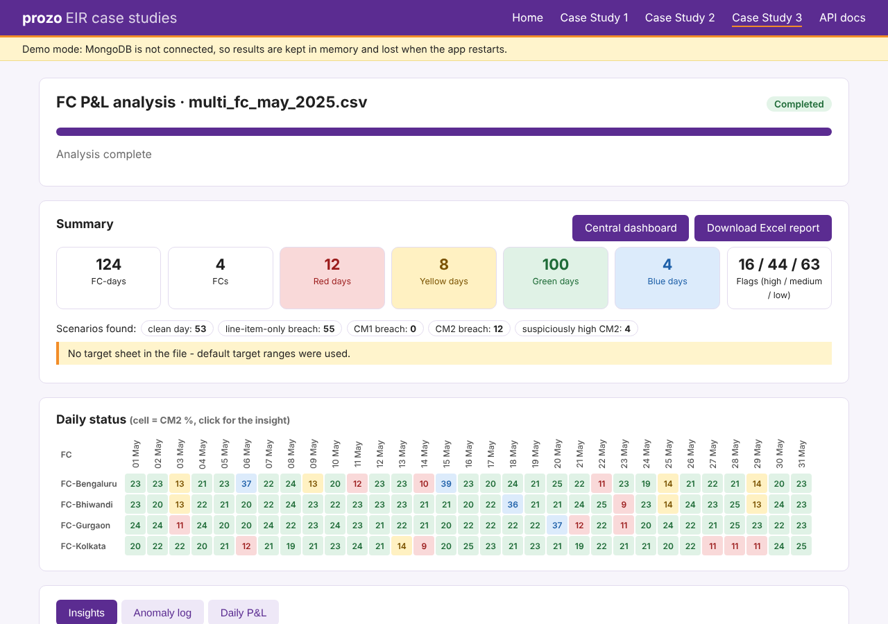
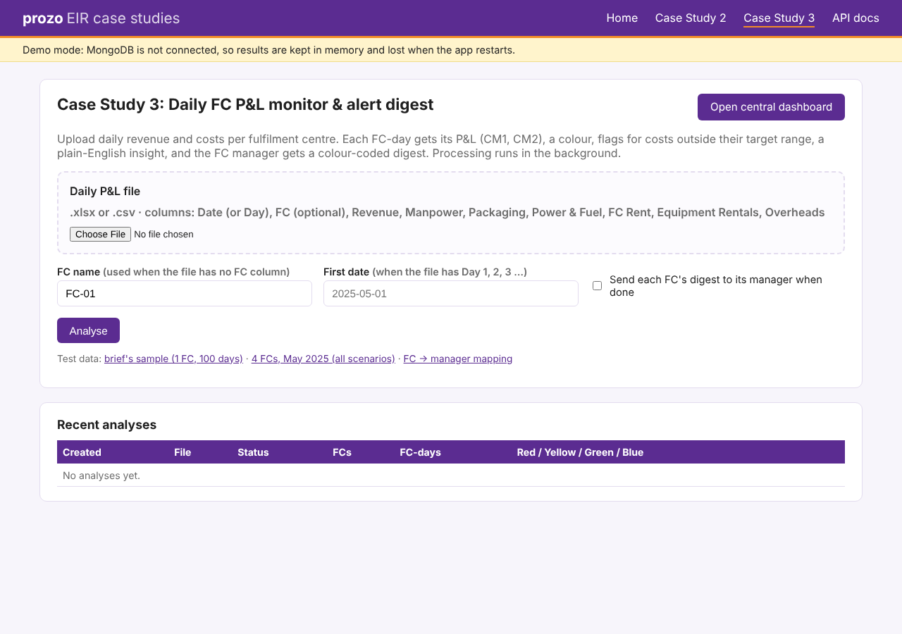
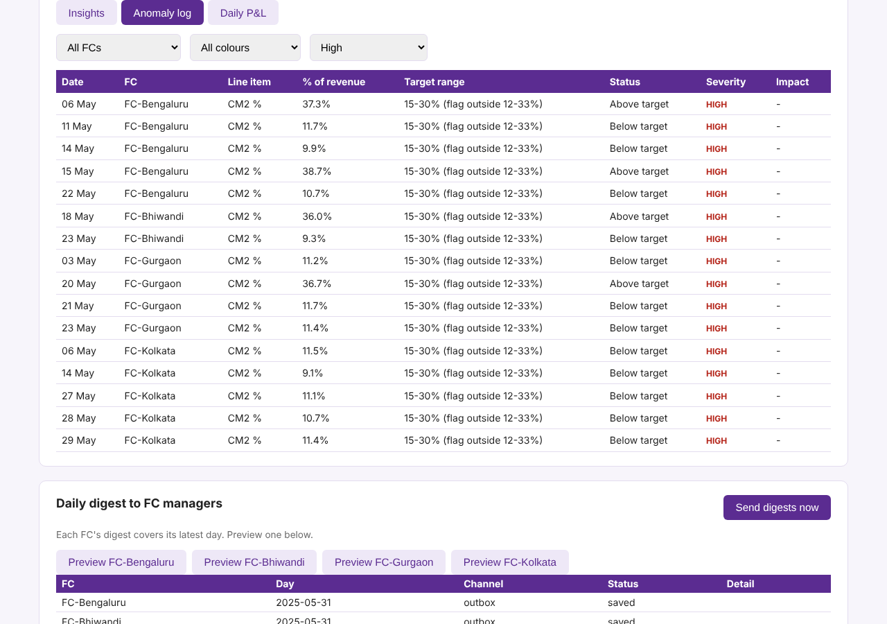
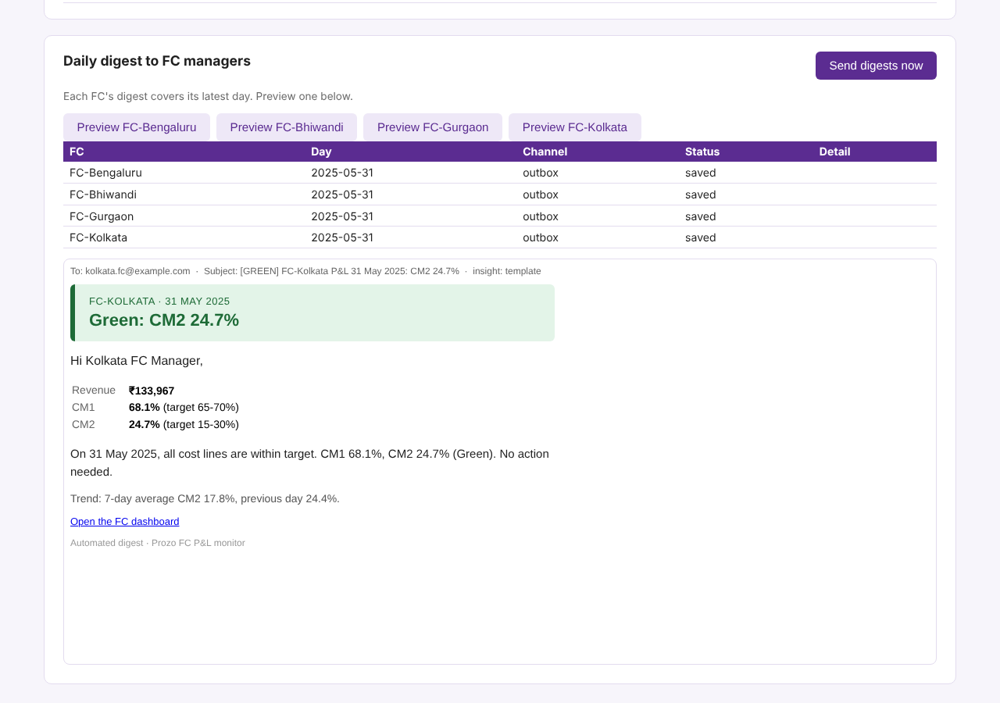
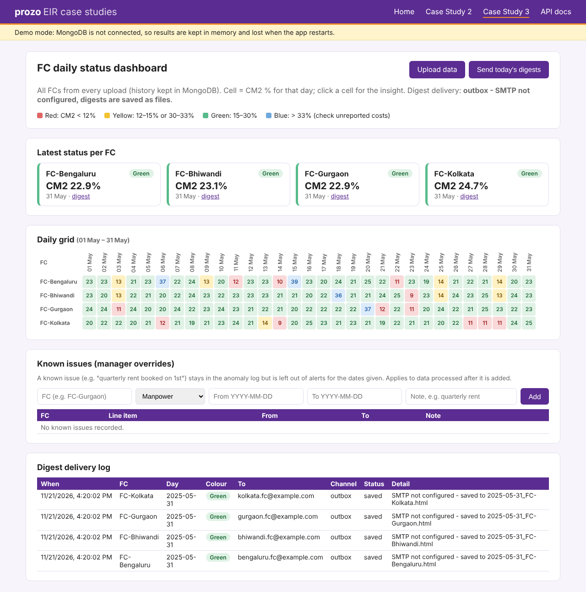
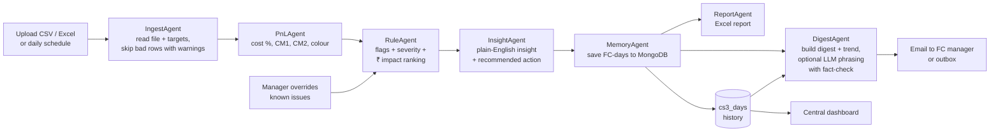

# Case Study 3: Daily FC P&L Monitor & Alert Digest

**Prozo EIR (Agentic AI): proof of concept.** Part of the same app as Case Study 2 (see [docs/case_study_2/README.md](../case_study_2/README.md); repository overview in the root [README.md](../../README.md)).

Every fulfilment centre (FC) produces daily revenue and cost data. This module calculates each FC-day's P&L, flags costs and margins outside target, explains the cause in plain English (ranked by rupee impact), and sends each FC manager a colour-coded daily digest. Leadership sees every FC on one dashboard.

| | |
|---|---|
| **Pages** | `/case-study-3` (upload) · `/case-study-3/runs/{id}` (results) · `/case-study-3/dashboard` (all FCs) |
| **Sample data** | Reproduces the brief's sample: 100 days → 86 Green, 11 Yellow, 3 Red, 0 Blue |
| **Extended data** | 4 FCs × 31 days with planted scenarios: all 124 FC-days classified as designed, covering a clean day, a CM2 breach, a cost-only breach and a suspiciously high CM2 |
| **Delivery** | Real email via SMTP (e.g. Gmail app password). Without SMTP, digests are saved to `storage/cs3_outbox/` and shown in the app |
| **Tests** | 36 tests for Case Study 3 (163 in the repo) |
| **Cost** | Free. The AI step is optional (Gemini free tier / Ollama) and can never change a number |



---

## 1. The problem in plain terms

Today someone checks spreadsheets by hand, so margin problems surface days late. The system must:

1. calculate **CM1 = Revenue − Manpower − Packaging** and **CM2 = CM1 − Power & Fuel − FC Rent − Equipment Rentals − Overheads**, both as % of revenue;
2. flag any cost line outside its target range, and CM1 / CM2 more than **±3 points** outside target (CM1 65–70%, CM2 15–30%);
3. colour each FC-day: 🔴 Red CM2 < 12% · 🟡 Yellow 12–15% or 30–33% · 🟢 Green 15–30% · 🔵 Blue > 33% (suspicious: possibly unreported costs);
4. write a plain-language insight per problem, with the top contributors and an action;
5. deliver a daily digest to each FC manager, plus a central dashboard.

---

## 2. Quick start

The app is shared with Case Study 2, so the setup is the same (see [the Case Study 2 quick start](../case_study_2/README.md#2-quick-start-under-15-minutes)):

```bash
source .venv/bin/activate && pip install -r requirements.txt
uvicorn app.main:app --reload            # or ./run.sh
# open http://localhost:8000/case-study-3
```

**Try it:** upload `data/case_study_3/multi_fc_may_2025.csv` (4 FCs, all scenarios) or the brief's `data/case_study_3/Case Study 3.xlsx`.

**Optional email delivery** (`.env`):

```
SMTP_HOST=smtp.gmail.com
SMTP_PORT=587
SMTP_USER=you@gmail.com
SMTP_PASSWORD=<16-character Gmail app password>
SMTP_FROM=you@gmail.com
CS3_DIGEST_TIME=20:30          # optional: send automatically every day at this time
```

Edit `data/case_study_3/fc_managers.csv` (columns `fc,manager,email`) to set who receives each FC's digest. The shipped file uses `@example.com` addresses.

```bash
python scripts/case_study_3/generate_test_data.py   # regenerate the extended test data (fixed seed)
python scripts/case_study_3/evaluate.py             # check colours + 124/124 scenarios, write outputs/case_study_3/*.xlsx
python -m pytest tests/case_study_3                 # Case Study 3 tests
```

---

## 3. Using the app

| Step | What happens |
|---|---|
| **1. Upload** a CSV / Excel on `/case-study-3`. For files with only "Day 1, 2, 3…" (like the brief's sample), enter the FC name and first date. Tick *Send each FC's digest* to email managers when processing finishes. |  |
| **2. Results** (`/case-study-3/runs/{id}`): colour counts, scenarios found, an FC × date colour grid (click a cell for its insight), then **Insights**, **Anomaly log** (filter by FC, colour, severity) and **Daily P&L** tabs. Download the Excel report. |  |
| **3. Digests:** preview any FC's digest and send all with one click. Delivery status is logged. |  |
| **4. Central dashboard** (`/case-study-3/dashboard`): every FC from every upload, latest status per FC, a 31-day grid, known issues (manager overrides) and the delivery log. |  |

---

## 4. Workflow: a pipeline of single-purpose agents



| Agent | Job | Deterministic? | Code |
|---|---|---|---|
| IngestAgent | Find the data table and the "Ideal FC Criteria" sheet in any sheet / column order; map column names; skip unusable rows with a reason | yes | `case_study_3/ingest.py` |
| PnLAgent | Each cost as % of revenue, CM1, CM1 %, CM2, CM2 %, colour | yes | `case_study_3/engine.py` |
| RuleAgent | Cost lines outside range; CM1 / CM2 beyond ±3 pts; severity; ₹ impact; apply known-issue overrides | yes | `case_study_3/engine.py` |
| InsightAgent | Template insight: deviation, breached lines, top contributors by ₹, action | yes | `case_study_3/insights.py` |
| MemoryAgent | Upsert every FC-day into MongoDB (`fc` + `date` key), so history builds up across uploads | yes | `case_study_3/repository.py` |
| ReportAgent | 5-sheet Excel report | yes | `case_study_3/report.py` |
| DigestAgent | Colour-coded HTML email per FC for its latest day, with a trend from memory; optional LLM phrasing | LLM optional | `case_study_3/digest.py`, `service.py` |
| Scheduler | Sends the day's digests automatically at `CS3_DIGEST_TIME` (skips FCs already sent) | yes | `case_study_3/scheduler.py` |

**Why a fixed pipeline, not a heavy agent framework:** the steps always run in the same order, and every number must be exact. A plain Python pipeline is easier to test, debug and change live. The only "AI" step re-phrases text, and its output is used only if **every number in it already appears in the facts**; otherwise the template text is used.

---

## 5. Rules (all in `app/case_study_3/rules.py`)

| Rule | Value |
|---|---|
| Cost targets (% of revenue) | Manpower 25–27 · Packaging 5–7 · Power & Fuel 10–12 · FC Rent 15–18 · Equipment Rentals 5–8 · Overheads 10–12. Read from the file's criteria sheet when present, otherwise these defaults |
| CM1 flag | outside 62–73% (65–70 ± 3) |
| CM2 flag | outside 12–33% (15–30 ± 3) |
| Colours | Red < 12 · Yellow 12–<15 and >30–33 · Green 15–30 · Blue > 33 |
| Gap handling | The brief leaves 14.9–15 and 32.9–33 undefined; those values count as **Yellow** |
| Severity | **High:** CM2 breach (Red / Blue). **Medium:** CM1 breach, or a cost > 2 pts above max. **Low:** smaller overrun, or a cost below its min |
| ₹ impact | `(actual % − max %) × revenue` for overruns; `(min % − actual %) × revenue` for under-runs |
| Day 1 date | Files without dates use Day N = start date + N − 1 (default 1 May 2025, which matches the brief's "May 27" example) |

**Below-min costs** are flagged as *Low, "confirm the cost was booked in full"*: spending less isn't a loss, but it can mean an entry is missing.

**Why severity matters:** in the brief's sample, **99 of 100 days** have at least one cost outside its range. Alerting on everything would train managers to ignore the digest. So the anomaly log keeps every flag (as the brief requires), while the digest leads with the high and medium items and the top 3 contributors by rupee impact.

### Example insight (generated)

> On 29 May 2025, CM2 = 11.4% (Red: below the 12% threshold, 3.6 pts under the 15% target). Top contributors: Manpower 31.4% (max 27%, ₹5,492 over), Power & Fuel 15.8% (max 12%, ₹4,691 over), Overheads 12.7% (max 12%, ₹851 over). Recommend: cost audit - review shift rosters and overtime against order volume; check power bills and DG-set running hours.
> *Trend: 3 Red days in a row, 7-day average CM2 16.7%, previous day 10.7%.*

---

## 6. Outputs

| Output | Where |
|---|---|
| Daily P&L per FC per day (each cost %, CM1, CM1 %, CM2, CM2 %, colour) | Results page → Daily P&L tab · Excel "Daily P&L" |
| Anomaly log: **Date \| FC \| Line Item \| % of Revenue \| Target Range \| Status** (+ severity, ₹ impact, known-issue note) | Results page → Anomaly log tab · Excel "Anomalies" |
| Plain-language insight + action per flagged FC-day | Results page → Insights · Excel "Insights" · grid cell click |
| Colour-coded daily digest per FC, to its manager | Email (SMTP) or `storage/cs3_outbox/*.html`; preview in app |
| Central status view across FCs | `/case-study-3/dashboard` · Excel "Dashboard" grid |

---

## 7. MongoDB data model

| Collection | One document per | Purpose |
|---|---|---|
| `cs3_runs` | upload | status, progress, summary, warnings, report path |
| `cs3_days` | FC per date (unique `fc + date`) | **memory**: P&L, colour, anomalies, insight. Re-uploading a day replaces it |
| `cs3_overrides` | known issue | FC, line item, date range, note |
| `cs3_digests` | digest sent | FC, day, recipient, channel, status |

---

## 8. API (`/api/cs3`, Swagger at `/docs`)

| Method | Path | Purpose |
|---|---|---|
| POST | `/runs` | multipart `data_file`, `fc_name`, `start_date`, `send_digests` → `202 {run_id}` |
| GET | `/runs`, `/runs/{id}` | list / status + summary |
| GET | `/runs/{id}/days` | computed daily P&L (`fc`, `colour` filters) |
| GET | `/runs/{id}/anomalies` | anomaly log (`fc`, `severity`, `open_only`) |
| GET | `/runs/{id}/report` | Excel |
| DELETE | `/runs/{id}` | delete an analysis: its record, uploaded file, report and the days it stored (days a later upload replaced are kept) |
| GET | `/digests/preview?fc=&date=` | digest HTML |
| POST | `/digests/send` | `{fcs?, date?}` → deliver |
| GET | `/dashboard` | each FC's last 31 days |
| GET/POST/DELETE | `/overrides` | known issues |

---

## 9. Test data and results

| File | Contents | Result |
|---|---|---|
| `data/case_study_3/Case Study 3.xlsx` | the brief's sample: 1 FC, 100 days, with criteria sheet | 86 Green · 11 Yellow · 3 Red · 0 Blue; 1 clean day, 86 cost-only breaches, 10 CM1 breaches, 3 CM2 breaches |
| `data/case_study_3/multi_fc_may_2025.csv` | generated: 4 FCs × 31 days with planted scenarios | 53 clean · 55 cost-only · 12 CM2 breach (incl. a 3-day Red streak) · 4 Blue. **124/124 match `expected_scenarios.csv`** |
| `data/case_study_3/bad_inputs/` | header only, missing column, not a P&L file, rows with zero / text / negative / bad dates | clear error, or the run completes with a warning per skipped row |

The brief asked the extended data to show **a clean day, a CM2 breach, a line-item-only breach and a suspiciously high CM2**. All four are present and asserted in `tests/case_study_3/test_data.py`.

---

## 10. Code structure

```
app/case_study_3/
├── rules.py          targets, colour bands, ±3 pt tolerance, severity, action texts
├── models.py         dataclasses: DayInput, Anomaly, DayResult, Override, Trend
├── ingest.py         IngestAgent: find the table + criteria sheet, map columns, skip bad rows
├── engine.py         PnLAgent + RuleAgent: percentages, CM1/CM2, colour, anomalies, ₹ impact
├── insights.py       InsightAgent: template insight per FC-day
├── digest.py         DigestAgent: HTML email per FC, trend lines, optional LLM wording
├── report.py         ReportAgent: 5-sheet Excel report
├── repository.py     MemoryAgent: MongoDB (cs3_runs, cs3_days, cs3_overrides, cs3_digests)
├── service.py        orchestrates the pipeline, background runs, delivery, delete
├── scheduler.py      daily digest at CS3_DIGEST_TIME
├── api.py            /api/cs3 endpoints
└── pages.py          /case-study-3, /case-study-3/runs/{id}, /case-study-3/dashboard
app/templates/case_study_3/   index.html · run.html · dashboard.html
app/static/js/case_study_3/   upload.js · run.js · dashboard.js · grid.js
data/case_study_3/            sample, generated data, answer key, managers, bad_inputs/
scripts/case_study_3/         generate_test_data.py · evaluate.py
outputs/case_study_3/         Excel reports from the sample and the generated data
tests/case_study_3/           test_engine.py · test_data.py · test_api.py
docs/case_study_3/            this README, the two Word documents, screenshots/
```

Shared code (Mongo connection, LLM clients, errors, page rendering) is in `app/shared/`.

---

## 11. Error handling

| Problem | Behaviour |
|---|---|
| Wrong file type / empty / too large | rejected straight away (400) with a message |
| No P&L table, missing cost column | run fails with a message naming what's missing |
| Zero or blank revenue, text or negative cost, bad date | that row is skipped and the reason is listed as a warning; the rest is processed |
| Duplicate FC-day | the later row is used, with a warning |
| No criteria sheet | default targets are used, and the run says so |
| SMTP not configured / email fails | outbox file instead / logged as failed with the reason; nothing crashes |
| LLM unavailable or invents a number | template insight is used |

---

## 12. How it gets smarter over time

**Already built:**

- **Memory of past days:** every FC-day is stored, and history accumulates across uploads. The digest uses it for "3 Red days in a row", the 7-day average CM2 and the previous day.
- **Manual overrides:** a manager records a known issue (e.g. *"quarterly rent booked on the 1st"*) for an FC, line and date range. It stays in the log but is left out of alerts.
- **Trend tracking:** the dashboard shows each FC's last 31 days at a glance.

**Next steps:**

1. **Per-FC baselines:** learn each FC's normal range (rolling median ± spread) and flag *changes*, not just fixed limits. A dark store and a large FC behave differently.
2. **Learn from overrides:** if a manager marks the same line as known on the same weekday or date of the month three times, suggest a standing rule.
3. **Escalation:** 3+ Red days in a row, or ₹ impact above a threshold, also alerts the regional head.
4. **Feedback on insights:** managers rate an alert as useful or noise; low-value rules get tuned.
5. **Forecast:** project month-end CM2 from the month so far and warn early.

---

## 13. Design decisions

| Decision | Why |
|---|---|
| Calculations in plain code; AI only for wording | P&L numbers must be exact and auditable; the LLM can't change a number (fact-check) |
| Fixed pipeline of agents | Predictable order, easy to test and demo; each agent is one function you can point to |
| Severity + ₹ ranking in the digest | The sample breaks a rule on 99% of days, so the digest must prioritise or it becomes noise |
| History in MongoDB keyed by FC + date | Re-uploads are safe (upsert); enables trends and the central dashboard |
| Email via SMTP, outbox fallback | A real channel with zero cost; the demo still works offline |
| Simple thread scheduler | No extra service to install; in production a cron job / cloud scheduler would call the same method |

---

## 14. Known limitations

- The brief's sample has no dates or FC names, so they come from the upload form (assumption: Day 1 = 1 May 2025).
- Overrides apply to data processed after they're added (re-upload to apply them to past days).
- Email delivery was not tested against a live SMTP server in my build environment (network restricted). The outbox path is fully tested. Gmail requires an app password.
- The in-process scheduler runs only while the app runs, and only in one app instance.
- The LLM phrasing is limited to digests (a few calls per day), not every log row, to stay within free-tier limits.

---

## 15. Interview guide

**3-minute demo:**

1. Upload `multi_fc_may_2025.csv` with *Send digests* ticked.
2. Show the colour grid, then click a Red cell for its insight.
3. Show the Anomaly log filtered to *high*.
4. Preview FC-Kolkata's digest for 29 May ("3 Red days in a row").
5. Show the central dashboard.
6. Add a known issue for FC-Bengaluru rent on 15 May, re-upload, and show it marked as known.

**Talking points:**

- "The maths is code, the words can be AI, and the AI can't change a number."
- "99 of 100 sample days break some rule. The value is in prioritising: severity plus rupee impact."
- "Memory turns a daily alert into a trend: three Red days in a row is a different conversation from one."

**Live-change cheatsheet:**

| Ask | Change |
|---|---|
| CM tolerance ±3 → ±2 | `CM_TOLERANCE_PTS` in `case_study_3/rules.py` |
| New target for Manpower | `DEFAULT_TARGETS` (or the file's criteria sheet) |
| Treat 14.9–15 as Green | `colour_for()` in `case_study_3/engine.py` |
| Show top 5 contributors | `TOP_CONTRIBUTORS_IN_DIGEST` |
| New recommended action text | `ACTION_ABOVE_MAX` |
| Different digest time | `CS3_DIGEST_TIME` in `.env` |

**Assumptions to confirm with Prozo:** the ±3-point reading (62–73 / 12–33), the gap values counting as Yellow, the default start date for undated files, and the FC → manager mapping.
